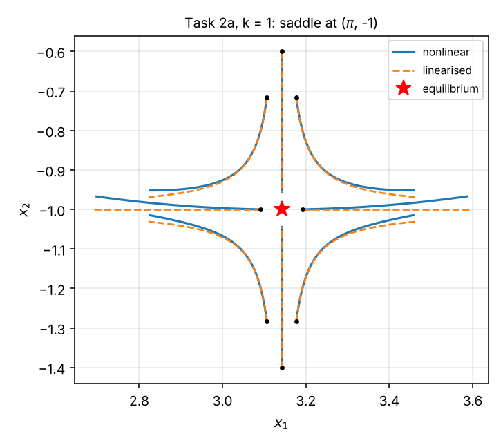

# Exercise 2 — System Properties and Linearization

Lecture: Week 02 — System properties and linearization of nonlinear systems. Problem sheet: Exercise 2 (keep a local copy in [`../course-material/`](../course-material/); it is not published here).

## Files

| File | What it contains |
|---|---|
| [`concepts.md`](concepts.md) | Signal manipulation (shift, scaling, the "replace $t$" rule), linearity, time invariance, causality, invertibility, stability, the lecture property table, nonlinear state space, equilibria, Jacobian linearization (pendulum, cart-pendulum), 2×2 eigenvalue toolkit, discrete-time solution formula, $A^k$ by diagonalization, modes, internal vs BIBO stability, cheat sheet |
| [`solutions.md`](solutions.md) | Task 1 (a–d), Task 2 (a, b, and the I/O relation), Task 3 (a–d), fully worked |
| [`python/task1_system_properties.py`](python/task1_system_properties.py) | Task 1: numerical tests of causality, time invariance and linearity + the counterexamples |
| [`python/task2_linearization.py`](python/task2_linearization.py) | Task 2: symbolic Jacobians, equilibria (with numerical root search), eigenvalues, transfer function, phase-plane figures |
| [`python/task3_discrete_time.py`](python/task3_discrete_time.py) | Task 3: iteration, closed forms of $x[k]$ and $A^k$, forced response, impulse response, figure |
| [`python/lecture_examples.py`](python/lecture_examples.py) | Lecture: pendulum and cart-pendulum linearizations |

Run any script with `python python/<name>.py` (needs `numpy scipy matplotlib sympy`).

## Progress

- [x] Lecture 2 concepts
- [x] Task 1 — System properties (causal, time-invariant, linear)
- [x] Task 2 — Linearization (two autonomous systems + I/O relation)
- [x] Task 3 — Evolution of a discrete-time system (internal and BIBO stability)

## Key results

- **Task 1** (causal / TI / linear): a) N Y Y · b) N N Y · c) Y N N · d) Y N Y.
- **Task 2a:** equilibria $(k\pi,(-1)^k)$; even $k$: $A = \mathrm{diag}(-1,-1)$ (stable), odd $k$: $A = \mathrm{diag}(1,-1)$ (saddle).
- **Task 2b:** equilibria $(0,0)$ (saddle) and $(0,-1)$ (stable node), and no others.
- **Task 2c:** at the origin $A = \begin{bmatrix}0&1\\0&-3\end{bmatrix}$, $B = \begin{bmatrix}0\\-1\end{bmatrix}$, $C = [1\ 0]$, $D = 0$.
- **Task 3:** eigenvalues $-1, -2$; $x[k] = (-1)^k[2,1]^\top - (-2)^k[1,1]^\top$ diverges; $B$ is the $\lambda = -2$ eigenvector, so the impulse response $(-2)^{k-1}[1,1]^\top$ is unbounded ⇒ not BIBO stable.

