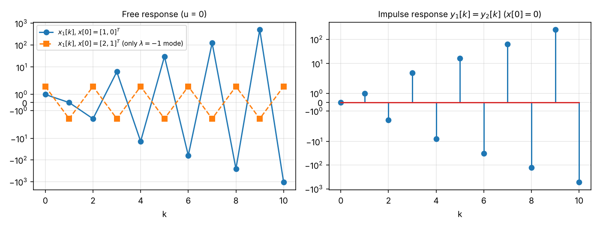

# Exercise 2 — Step-by-Step Solutions

**Course:** Advanced System Theory (Paderborn University, Automatic Control Group RAT, Prof. Dr. Erdal Kayacan)
**Covers:** Task 1 (a–d), Task 2 (a, b and the I/O-relation part, called "2c" here because the sheet labels it "b" twice), Task 3 (a–d)
**Checking:** no official solution was available when this was written. Every result is verified by the scripts in [`python/`](python/) (symbolic algebra with SymPy, numerical search, simulation).

Every step is written out. References like "Concepts §3.2" point to [`concepts.md`](concepts.md).

---

## Contents

- [Task 1 — System properties](#task-1--system-properties)
- [Task 2a — Linearization of $\dot x_1 = -\sin x_1,\ \dot x_2 = -x_2 + \cos x_1$](#task-2a--linearization)
- [Task 2b — Linearization of the second nonlinear system](#task-2b--linearization-of-the-second-nonlinear-system)
- [Task 2c — State space and linearization of the I/O relation](#task-2c--state-space-and-linearization-of-the-io-relation)
- [Task 3 — Evolution of a discrete-time system](#task-3--evolution-of-a-discrete-time-system)
- [Summary of results](#summary-of-results)

---

## Task 1 — System properties

For each system we test **causality** (Concepts §4.2), **time invariance** (two-path test, §3.2) and **linearity** (§2.3). A "Yes" is proved in general; a "No" is shown with one counterexample (§1.3). Throughout, $A\ne0$ and $f_0\ne0$ (special cases are noted at the end).

### 1(a) $\;y(t) = u(t) - 0.5\,u(t+1)$

**Causality.** The output at time $t$ reads the input at $t$ and at $t + 1$. The read time $t + 1 > t$ lies in the future for every $t$.

*Counterexample.* Fix any $T$. Let $u_1 \equiv 0$ and $u_2(t) = 0$ for $t\le T$, $u_2(t) = 1$ for $t > T$. The inputs agree for all $t\le T$. At $t = T$:
$y_1(T) = 0$, but $y_2(T) = u_2(T) - 0.5\,u_2(T+1) = 0 - 0.5 = -0.5$. The outputs differ at a time $\le T$ ⇒ **not causal**.

**Time invariance.**
- Path 1 (shift, then system): input $u_T(t) = u(t - T)$ gives
  $y_T(t) = u_T(t) - 0.5\,u_T(t+1) = u(t - T) - 0.5\,u(t + 1 - T)$.
- Path 2 (system, then shift): replace every $t$ by $t - T$:
  $y(t - T) = u(t - T) - 0.5\,u(t - T + 1)$.
- Identical for every $u$, $t$, $T$ ⇒ **time-invariant**.

**Linearity.** Let $u_3 = \alpha_1u_1 + \alpha_2u_2$:

$$
y_3(t) = u_3(t) - 0.5\,u_3(t+1) = \alpha_1u_1(t) + \alpha_2u_2(t) - 0.5\big(\alpha_1u_1(t+1) + \alpha_2u_2(t+1)\big)
= \alpha_1\underbrace{\big(u_1(t) - 0.5u_1(t+1)\big)}_{y_1(t)} + \alpha_2\underbrace{\big(u_2(t) - 0.5u_2(t+1)\big)}_{y_2(t)} .
$$

⇒ **linear**.

*Interpretation:* an LTI system that "looks one second ahead" — perfectly linear and time-invariant, but cannot be built as a real-time device.

### 1(b) $\;y(t) = u(2t)$

**Causality.** The read time is $s(t) = 2t$. For $t > 0$, $2t > t$: the output needs future input values. (For $t < 0$ it reads the past, but causality must hold for all $t$.)

*Counterexample.* $T = 1$, $u_1\equiv0$, $u_2(t) = 0$ for $t\le1$ and $1$ for $t > 1$. They agree for $t\le1$. At $t = 0.75\le1$: $y_1(0.75) = u_1(1.5) = 0$, $y_2(0.75) = u_2(1.5) = 1$ ⇒ **not causal**.

**Time invariance.** Careful use of the "replace $t$" rule (Concepts §1.2):
- Path 1: $u_T(t) = u(t - T)$. The system reads its input at time $2t$, so
  $y_T(t) = u_T(2t) = u(2t - T)$.
- Path 2: $y(t - T) = u\big(2(t - T)\big) = u(2t - 2T)$.
- These differ: the delay at the output is $T/2$ instead of $T$ (the compression also compresses the delay).

*Counterexample.* $u$ = unit step ($u(t) = 1$ for $t\ge0$, else $0$), $T = 1$, $t = 0.75$: path 1 gives $u(0.5) = 1$, path 2 gives $u(-0.5) = 0$ ⇒ **time-variant**.

**Linearity.** With $u_3 = \alpha_1u_1 + \alpha_2u_2$: $y_3(t) = u_3(2t) = \alpha_1u_1(2t) + \alpha_2u_2(2t) = \alpha_1y_1(t) + \alpha_2y_2(t)$ ⇒ **linear**. (Changing the time argument never destroys linearity.)

*Interpretation:* playing a recording at double speed. It is linear, but a 1 s delay of the recording shows up as only 0.5 s at the output, and to play at double speed in real time you would need the future of the recording.

### 1(c) $\;y(t) = A\cos\!\big(2\pi f_0t + u(t)\big)$

This is **phase modulation**: the input sets the phase of a carrier.

**Causality.** Memoryless: $y(t)$ uses $u$ only at the same instant $t$ ⇒ **causal**. (If $u_1 = u_2$ for $t\le T$, then $y_1(t) = A\cos(2\pi f_0t + u_1(t)) = A\cos(2\pi f_0t + u_2(t)) = y_2(t)$ for $t\le T$.)

**Time invariance.**
- Path 1: $y_T(t) = A\cos\!\big(2\pi f_0t + u(t - T)\big)$ — the carrier term $2\pi f_0t$ is *not* shifted, because it is part of the system, not of the input.
- Path 2: $y(t - T) = A\cos\!\big(2\pi f_0(t - T) + u(t - T)\big)$.

*Counterexample.* $u\equiv0$, $T = \frac{1}{4f_0}$ (a quarter period), $t = 0$: path 1 gives $A\cos 0 = A$; path 2 gives $A\cos(-\pi/2) = 0$. Different ⇒ **time-variant**. The explicit $t$ in the carrier is the red flag (Concepts §3.3).

**Linearity.** Zero-in-zero-out test (§2.3): $u\equiv0$ gives $y(t) = A\cos(2\pi f_0t)\not\equiv0$ ⇒ **not linear**. (Also homogeneity fails in general: $A\cos(2\pi f_0t + 2u)\ne 2A\cos(2\pi f_0t + u)$; the input sits inside the cosine.)

### 1(d) $\;y(t) = u(t)\cos(2\pi f_0t + \phi)$

This is **amplitude modulation** (a mixer): the input multiplies a carrier.

**Causality.** Memoryless ⇒ **causal**.

**Time invariance.**
- Path 1: $y_T(t) = u(t - T)\cos(2\pi f_0t + \phi)$.
- Path 2: $y(t - T) = u(t - T)\cos\!\big(2\pi f_0(t - T) + \phi\big)$.

*Counterexample.* $u\equiv1$, $T = \frac{1}{4f_0}$, $t = -\frac{\phi}{2\pi f_0}$ (so that $2\pi f_0t + \phi = 0$): path 1 gives $\cos0 = 1$, path 2 gives $\cos(-\pi/2) = 0$ ⇒ **time-variant**.

**Linearity.** Let $c(t) = \cos(2\pi f_0t + \phi)$, a known function of time that does not depend on $u$:

$$
y_3(t) = \big(\alpha_1u_1(t) + \alpha_2u_2(t)\big)c(t) = \alpha_1u_1(t)c(t) + \alpha_2u_2(t)c(t) = \alpha_1y_1(t) + \alpha_2y_2(t)
$$

⇒ **linear** (a linear, time-varying system).

**Compare (c) and (d):** both contain a carrier with an explicit $t$, so both are time-variant. In (d) the input multiplies the cosine (linear); in (c) it sits inside the cosine (nonlinear).

### Summary table and special cases

| System | Causal | Time-invariant | Linear |
|---|:---:|:---:|:---:|
| a) $u(t) - 0.5\,u(t+1)$ | N | Y | Y |
| b) $u(2t)$ | N | N | Y |
| c) $A\cos(2\pi f_0t + u(t))$ | Y | N | N |
| d) $u(t)\cos(2\pi f_0t + \phi)$ | Y | N | Y |

*Special parameter values.* If $f_0 = 0$, the explicit time dependence disappears: (c) becomes $A\cos(u(t))$ and (d) becomes $u(t)\cos\phi$, both time-invariant; (c) stays nonlinear unless $A = 0$ (then $y\equiv0$, which is trivially linear and TI).

*Extra (not asked):* (a) and (d) are BIBO stable ($\lvert y\rvert\le1.5M$ and $\lvert y\rvert\le M$); (b) and (c) too ($\lvert y\rvert\le M$, $\lvert y\rvert\le\lvert A\rvert$).

*Check:* `python/task1_system_properties.py` tests all three properties numerically on random signals and reproduces the table and both counterexamples.

---

## Task 2a — Linearization

$$
\dot x_1 = -\sin x_1 =: f_1(x),\qquad \dot x_2 = -x_2 + \cos x_1 =: f_2(x).
$$

The system is autonomous (no input), so the linear model is $\Delta\dot x = A\,\Delta x$.

### Step 1 — Equilibria

Solve $f_1 = 0$, $f_2 = 0$ (Concepts §8.2). The first equation contains only $x_1$:

$$
-\sin x_1 = 0 \iff x_1 = k\pi,\quad k\in\mathbb{Z}.
$$

Substitute into the second: $-x_2 + \cos(k\pi) = 0 \iff x_2 = \cos(k\pi) = (-1)^k$.

$$
\boxed{\;x_0^{(k)} = \big(k\pi,\ (-1)^k\big),\qquad k\in\mathbb{Z}\;}
$$

So there are infinitely many isolated equilibria, in two families:
- $k$ even: $(0, 1), (\pm2\pi, 1), (\pm4\pi, 1),\dots$
- $k$ odd: $(\pm\pi, -1), (\pm3\pi, -1),\dots$

*Check $k = 1$:* $f_1 = -\sin\pi = 0$, $f_2 = -(-1) + \cos\pi = 1 - 1 = 0$ ✓.

### Step 2 — Jacobian (symbolic)

$$
\frac{\partial f}{\partial x} = \begin{bmatrix}
\frac{\partial f_1}{\partial x_1} & \frac{\partial f_1}{\partial x_2}\\[2pt]
\frac{\partial f_2}{\partial x_1} & \frac{\partial f_2}{\partial x_2}
\end{bmatrix} = \begin{bmatrix} -\cos x_1 & 0\\ -\sin x_1 & -1\end{bmatrix}.
$$

($\partial(-\sin x_1)/\partial x_1 = -\cos x_1$; $f_1$ does not contain $x_2$; $\partial(\cos x_1)/\partial x_1 = -\sin x_1$; $\partial(-x_2)/\partial x_2 = -1$.)

### Step 3 — Evaluate at the equilibria

Use $\cos(k\pi) = (-1)^k$, $\sin(k\pi) = 0$:

$$
A^{(k)} = \begin{bmatrix} -(-1)^k & 0\\ 0 & -1\end{bmatrix}
\quad\Longrightarrow\quad
A_{\text{even}} = \begin{bmatrix}-1 & 0\\ 0 & -1\end{bmatrix},\qquad
A_{\text{odd}} = \begin{bmatrix}1 & 0\\ 0 & -1\end{bmatrix}.
$$

### Step 4 — Linearized models

With $\Delta x = x - x_0^{(k)}$:

$$
\boxed{\;k\ \text{even}:\ \begin{bmatrix}\Delta\dot x_1\\ \Delta\dot x_2\end{bmatrix} = \begin{bmatrix}-1 & 0\\ 0 & -1\end{bmatrix}\begin{bmatrix}\Delta x_1\\ \Delta x_2\end{bmatrix},\qquad
k\ \text{odd}:\ \begin{bmatrix}\Delta\dot x_1\\ \Delta\dot x_2\end{bmatrix} = \begin{bmatrix}1 & 0\\ 0 & -1\end{bmatrix}\begin{bmatrix}\Delta x_1\\ \Delta x_2\end{bmatrix}\;}
$$

where, e.g. for $k = 0$, $\Delta x_1 = x_1$, $\Delta x_2 = x_2 - 1$; for $k = 1$, $\Delta x_1 = x_1 - \pi$, $\Delta x_2 = x_2 + 1$.

### Step 5 — Interpretation (Concepts §10)

The matrices are diagonal, so the eigenvalues are the diagonal entries.
- $k$ even: $\lambda = -1, -1$ ⇒ both negative ⇒ **locally asymptotically stable** (stable node). Small deviations decay like $e^{-t}$.
- $k$ odd: $\lambda = +1, -1$ ⇒ **saddle, unstable**. Deviations in $x_1$ grow like $e^{t}$; deviations in $x_2$ decay.

Physically this is the same structure as the pendulum: $\dot x_1 = -\sin x_1$ pushes $x_1$ towards the nearest even multiple of $\pi$ and away from odd multiples; $x_2$ simply follows $\cos x_1$ with a first-order lag.

*Check:* `python/task2_linearization.py` (symbolic Jacobians for $k = -2,\dots,2$); figures [`task2a_k0_stable.png`](python/figures/task2a_k0_stable.png) and [`task2a_k1_saddle.png`](python/figures/task2a_k1_saddle.png) overlay nonlinear and linearized trajectories.

---

## Task 2b — Linearization of the second nonlinear system

$$
\begin{aligned}
\dot x_1 &= x_1^2 + x_2^2 + x_2\cos x_1 =: f_1(x),\\
\dot x_2 &= (1 + x_1)x_1 + (1 + x_2)x_2 + x_1\sin x_2 = x_1 + x_1^2 + x_2 + x_2^2 + x_1\sin x_2 =: f_2(x).
\end{aligned}
$$

### Step 1 — Equilibria

We need

$$
\text{(I)}\quad x_1^2 + x_2^2 + x_2\cos x_1 = 0,\qquad
\text{(II)}\quad x_1^2 + x_2^2 + x_1 + x_2 + x_1\sin x_2 = 0 .
$$

**Obvious candidate.** $x = (0,0)$: (I) $= 0$, (II) $= 0$ ✓.

**Look along $x_1 = 0$.** Then (I) becomes $x_2^2 + x_2 = x_2(x_2 + 1) = 0$ and (II) becomes $x_2^2 + x_2 = 0$ — the same equation. So $x_2 = 0$ or $x_2 = -1$:

$$
(0, 0)\quad\text{and}\quad(0, -1).
$$

*Check $(0,-1)$:* (I) $= 0 + 1 + (-1)\cos0 = 0$ ✓; (II) $= 0 + 1 + 0 - 1 + 0 = 0$ ✓.

**Are there others?** We show there are none (Concepts §8.2, steps 4–5).

*(i) Confine the solutions.* From (I), $x_1^2 + x_2^2 = -x_2\cos x_1 \le \lvert x_2\rvert$ (because $\lvert\cos\rvert\le1$). Hence $x_2^2\le\lvert x_2\rvert$, i.e. $\lvert x_2\rvert\le1$, and $x_1^2\le\lvert x_2\rvert - x_2^2\le\frac14$ (the maximum of $s - s^2$ is $\frac14$), i.e. $\lvert x_1\rvert\le\frac12$. Then $\cos x_1 > 0$, and since $-x_2\cos x_1 = x_1^2 + x_2^2\ge0$ we get $x_2\le0$. So every equilibrium lies in $\lvert x_1\rvert\le\frac12$, $-1\le x_2\le0$.

*(ii) Combine the equations.* Subtract (I) from (II):

$$
x_1 + x_2 + x_1\sin x_2 - x_2\cos x_1 = 0
\quad\Longleftrightarrow\quad
x_1\,(1 + \sin x_2) = -x_2\,(1 - \cos x_1). \tag{III}
$$

In the region from (i): $1 + \sin x_2\ge 1 - \sin 1\approx0.159 > 0$, $-x_2\ge0$, $1 - \cos x_1\ge0$. So the right side is $\ge0$, hence $x_1\ge0$.

*(iii) Rule out $x_1 > 0$.* Suppose $x_1 > 0$. Using $1 - \cos x_1\le x_1^2/2$ and $\lvert x_2\rvert\le1$ in (III):
$x_1(1 + \sin x_2)\le x_1^2/2$, so $1 + \sin x_2\le x_1/2\le\frac14$, which forces $\sin x_2\le-\frac34$, i.e. $x_2\le\arcsin(-0.75)\approx-0.848$. Feeding this back into $x_1^2\le\lvert x_2\rvert(1 - \lvert x_2\rvert)$ (from (i)) gives $x_1^2\le0.848\cdot0.152\approx0.129$, so $x_1\le0.359$; then $1 + \sin x_2\le0.180$, $\sin x_2\le -0.820$, $x_2\le-0.961$, so $x_1^2\le0.961\cdot0.039\approx0.037$, $x_1\le0.194$; then $1 + \sin x_2\le0.097$, i.e. $\sin x_2\le-0.903$. (Each time we use that $s(1 - s)$ decreases for $s > \frac12$, so its largest value on $[\lvert x_2\rvert_{\min}, 1]$ is at the left end.) But on $[-1, 0]$, $\sin x_2\ge\sin(-1)\approx-0.841$. Contradiction. Hence $x_1 = 0$, and we already solved that case.

$$
\boxed{\;\text{equilibria: } x_0^{(1)} = (0, 0),\qquad x_0^{(2)} = (0, -1)\;}
$$

(The script additionally runs a dense numerical root search on $[-3,3]^2$ and finds exactly these two points.)

### Step 2 — Jacobian (symbolic)

Differentiate term by term (Concepts §9.3 table):

$$
\frac{\partial f_1}{\partial x_1} = 2x_1 - x_2\sin x_1,\quad
\frac{\partial f_1}{\partial x_2} = 2x_2 + \cos x_1,\quad
\frac{\partial f_2}{\partial x_1} = 1 + 2x_1 + \sin x_2,\quad
\frac{\partial f_2}{\partial x_2} = 1 + 2x_2 + x_1\cos x_2 .
$$

$$
\frac{\partial f}{\partial x} = \begin{bmatrix}2x_1 - x_2\sin x_1 & 2x_2 + \cos x_1\\ 1 + 2x_1 + \sin x_2 & 1 + 2x_2 + x_1\cos x_2\end{bmatrix}.
$$

### Step 3 — Evaluate at $(0,0)$

$\sin0 = 0$, $\cos0 = 1$:

$$
A^{(1)} = \begin{bmatrix}0 - 0 & 0 + 1\\ 1 + 0 + 0 & 1 + 0 + 0\end{bmatrix} = \begin{bmatrix}0 & 1\\ 1 & 1\end{bmatrix},
\qquad \boxed{\;\Delta\dot x = \begin{bmatrix}0 & 1\\ 1 & 1\end{bmatrix}\Delta x,\quad \Delta x = x\;}
$$

Eigenvalues: $\operatorname{tr} = 1$, $\det = 0\cdot1 - 1\cdot1 = -1$, so $\lambda^2 - \lambda - 1 = 0$, $\lambda = \frac{1\pm\sqrt5}{2}\approx1.618,\ -0.618$. $\det < 0$ ⇒ **saddle, unstable**.

### Step 4 — Evaluate at $(0,-1)$

$\sin0 = 0$, $\cos0 = 1$, $\sin(-1) = -\sin1$, $\cos(-1) = \cos1$:

$$
A^{(2)} = \begin{bmatrix}0 - (-1)\cdot0 & -2 + 1\\ 1 + 0 - \sin1 & 1 - 2 + 0\end{bmatrix}
= \begin{bmatrix}0 & -1\\ 1 - \sin1 & -1\end{bmatrix}
\approx\begin{bmatrix}0 & -1\\ 0.1585 & -1\end{bmatrix}.
$$

$$
\boxed{\;\Delta\dot x = \begin{bmatrix}0 & -1\\ 1 - \sin1 & -1\end{bmatrix}\Delta x,\qquad \Delta x = \begin{bmatrix}x_1\\ x_2 + 1\end{bmatrix}\;}
$$

Eigenvalues: $\operatorname{tr} = -1$, $\det = 0\cdot(-1) - (-1)(1 - \sin1) = 1 - \sin1\approx0.1585$:

$$
\lambda = \frac{-1\pm\sqrt{1 - 4(1 - \sin1)}}{2} = \frac{-1\pm\sqrt{4\sin1 - 3}}{2}\approx -0.198,\ -0.802 .
$$

$\operatorname{tr} < 0$, $\det > 0$ ⇒ both negative real ⇒ **stable node, locally asymptotically stable**.

*Check:* `python/task2_linearization.py`; figure [`task2b_stable_node.png`](python/figures/task2b_stable_node.png).

---

## Task 2c — State space and linearization of the I/O relation

$$
\ddot y + (3 + \dot y^2)\,\dot y + (1 + y + y^2)\,u = 0,\qquad x = \begin{bmatrix}x_1\\ x_2\end{bmatrix} = \begin{bmatrix}y\\ \dot y\end{bmatrix}.
$$

### Step 1 — Nonlinear state-space model (Concepts §7.2)

Solve for the highest derivative: $\ddot y = -(3 + \dot y^2)\dot y - (1 + y + y^2)u$. Then

$$
\boxed{\;
\begin{aligned}
\dot x_1 &= x_2 &&=: f_1(x,u)\\
\dot x_2 &= -(3 + x_2^2)\,x_2 - (1 + x_1 + x_1^2)\,u &&=: f_2(x,u)\\
y &= x_1 &&=: g(x,u)
\end{aligned}\;}
$$

Expanded: $f_2 = -3x_2 - x_2^3 - u - x_1u - x_1^2u$.

### Step 2 — Check that the origin is an equilibrium

$f_1(0,0) = 0$, $f_2(0,0) = -(3 + 0)\cdot0 - (1 + 0 + 0)\cdot0 = 0$ ✓. So $(x^\ast, u^\ast) = (0, 0)$ is an equilibrium and $y^\ast = g(0,0) = 0$.

*(Bonus: all equilibria.)* $f_1 = 0\Rightarrow x_2 = 0$; then $f_2 = -(1 + x_1 + x_1^2)u = 0$. The factor $1 + x_1 + x_1^2 = (x_1 + \tfrac12)^2 + \tfrac34 > 0$ never vanishes, so $u^\ast = 0$. Hence the equilibria are $(x_1^\ast, 0)$ with **any** $x_1^\ast$ and $u^\ast = 0$ — a whole line. Constant nonzero inputs have no equilibrium.

### Step 3 — Jacobians

$$
\frac{\partial f}{\partial x} = \begin{bmatrix}0 & 1\\ -(1 + 2x_1)\,u & -3 - 3x_2^2\end{bmatrix},\qquad
\frac{\partial f}{\partial u} = \begin{bmatrix}0\\ -(1 + x_1 + x_1^2)\end{bmatrix},\qquad
\frac{\partial g}{\partial x} = \begin{bmatrix}1 & 0\end{bmatrix},\qquad
\frac{\partial g}{\partial u} = 0 .
$$

(For $\partial f_2/\partial x_2$: $\frac{\partial}{\partial x_2}(-3x_2 - x_2^3) = -3 - 3x_2^2$. For $\partial f_2/\partial x_1$: $\frac{\partial}{\partial x_1}\big(-(1 + x_1 + x_1^2)u\big) = -(1 + 2x_1)u$.)

### Step 4 — Evaluate at $(x^\ast,u^\ast) = (0,0)$

$$
\boxed{\;
A = \begin{bmatrix}0 & 1\\ 0 & -3\end{bmatrix},\quad
B = \begin{bmatrix}0\\ -1\end{bmatrix},\quad
C = \begin{bmatrix}1 & 0\end{bmatrix},\quad
D = 0,\qquad
\Delta\dot x = A\Delta x + B\Delta u,\ \ \Delta y = C\Delta x\;}
$$

Here $\Delta x = x$, $\Delta u = u$, $\Delta y = y$ because the operating point is the origin. Note that $\partial f_2/\partial x_1 = -(1 + 2x_1)u$ vanishes because $u^\ast = 0$: around the origin the dependence of the gain on $y$ is a second-order effect.

**Equivalent linear I/O relation.** $\Delta\dot x_1 = \Delta x_2$, $\Delta\dot x_2 = -3\Delta x_2 - \Delta u$, $\Delta y = \Delta x_1$ give

$$
\Delta\ddot y + 3\,\Delta\dot y + \Delta u = 0,\qquad G(s) = \frac{-1}{s(s + 3)} .
$$

This is exactly what you get by dropping all products of small quantities ($\dot y^3$, $yu$, $y^2u$) in the original equation — a good sanity check.

### Step 5 — Interpretation

$A$ is upper triangular, so its eigenvalues are $0$ and $-3$. The eigenvalue $0$ reflects the line of equilibria: shifting $y$ by a constant (with $u = 0$, $\dot y = 0$) gives another equilibrium, so a perturbation of $y$ neither decays nor grows. Because one eigenvalue has zero real part, the linearization alone cannot decide the stability of the nonlinear system (Concepts §10.3).

*Check:* `python/task2_linearization.py` computes $A, B, C, D$, the eigenvalues and $G(s)$ symbolically.

---

## Task 3 — Evolution of a discrete-time system

$$
x[k+1] = \underbrace{\begin{bmatrix}0 & -2\\ 1 & -3\end{bmatrix}}_{A}x[k] + \underbrace{\begin{bmatrix}1\\ 1\end{bmatrix}}_{B}u[k],\qquad y[k] = x[k]\ \ (C = I,\ D = 0).
$$

### Preparation — eigenvalues and eigenvectors of $A$ (Concepts §12.1)

$\operatorname{tr}A = -3$, $\det A = 0\cdot(-3) - (-2)\cdot1 = 2$:

$$
\det(\lambda I - A) = \lambda^2 + 3\lambda + 2 = (\lambda + 1)(\lambda + 2) = 0\ \Longrightarrow\ \lambda_1 = -1,\quad \lambda_2 = -2 .
$$

- $\lambda_1 = -1$: $A + I = \begin{bmatrix}1 & -2\\ 1 & -2\end{bmatrix}$, row gives $v_1 - 2v_2 = 0$ ⇒ $v_1 = \begin{bmatrix}2\\ 1\end{bmatrix}$. Check: $Av_1 = \begin{bmatrix}0 - 2\\ 2 - 3\end{bmatrix} = \begin{bmatrix}-2\\ -1\end{bmatrix} = -v_1$ ✓.
- $\lambda_2 = -2$: $A + 2I = \begin{bmatrix}2 & -2\\ 1 & -1\end{bmatrix}$, row gives $v_1 - v_2 = 0$ ⇒ $v_2 = \begin{bmatrix}1\\ 1\end{bmatrix}$. Check: $Av_2 = \begin{bmatrix}-2\\ 1 - 3\end{bmatrix} = -2v_2$ ✓.

**Notice:** $B = v_2$. The input enters exactly along the eigenvector of $\lambda_2 = -2$. This will matter in (c) and (d).

### 3(a) — Iteration and closed form ($u\equiv0$, $x[0] = [1,\ 0]^\top$)

**Iteration** ($x[k+1] = Ax[k]$, row times column):

$$
x[1] = \begin{bmatrix}0 & -2\\ 1 & -3\end{bmatrix}\begin{bmatrix}1\\ 0\end{bmatrix} = \begin{bmatrix}0\cdot1 + (-2)\cdot0\\ 1\cdot1 + (-3)\cdot0\end{bmatrix} = \begin{bmatrix}0\\ 1\end{bmatrix},
$$

$$
x[2] = A\begin{bmatrix}0\\ 1\end{bmatrix} = \begin{bmatrix}0 - 2\\ 0 - 3\end{bmatrix} = \begin{bmatrix}-2\\ -3\end{bmatrix},\qquad
x[3] = A\begin{bmatrix}-2\\ -3\end{bmatrix} = \begin{bmatrix}0 + 6\\ -2 + 9\end{bmatrix} = \begin{bmatrix}6\\ 7\end{bmatrix}.
$$

**Closed form, method 1 (decompose $x[0]$, Concepts §12.2).** Write $x[0] = c_1v_1 + c_2v_2$:

$$
\begin{bmatrix}1\\ 0\end{bmatrix} = c_1\begin{bmatrix}2\\ 1\end{bmatrix} + c_2\begin{bmatrix}1\\ 1\end{bmatrix}
\iff \begin{cases}2c_1 + c_2 = 1\\ c_1 + c_2 = 0\end{cases}
\iff c_1 = 1,\ c_2 = -1 .
$$

Since $A^kv_i = \lambda_i^kv_i$:

$$
\boxed{\;x[k] = (-1)^k\begin{bmatrix}2\\ 1\end{bmatrix} - (-2)^k\begin{bmatrix}1\\ 1\end{bmatrix} = \begin{bmatrix}2(-1)^k - (-2)^k\\ (-1)^k - (-2)^k\end{bmatrix}\;}
$$

*Check:* $k = 0$: $[2 - 1,\ 1 - 1] = [1, 0]$ ✓; $k = 1$: $[-2 + 2,\ -1 + 2] = [0, 1]$ ✓; $k = 2$: $[2 - 4,\ 1 - 4] = [-2, -3]$ ✓; $k = 3$: $[-2 + 8,\ -1 + 8] = [6, 7]$ ✓.

**Closed form, method 2 (general $A^k$, Concepts §12.3).** $V = [v_1\ v_2] = \begin{bmatrix}2 & 1\\ 1 & 1\end{bmatrix}$, $\det V = 1$, $V^{-1} = \begin{bmatrix}1 & -1\\ -1 & 2\end{bmatrix}$, $\Lambda = \operatorname{diag}(-1, -2)$:

$$
A^k = V\Lambda^kV^{-1} = (-1)^k\begin{bmatrix}2\\ 1\end{bmatrix}\begin{bmatrix}1 & -1\end{bmatrix} + (-2)^k\begin{bmatrix}1\\ 1\end{bmatrix}\begin{bmatrix}-1 & 2\end{bmatrix}
= (-1)^k\begin{bmatrix}2 & -2\\ 1 & -1\end{bmatrix} + (-2)^k\begin{bmatrix}-1 & 2\\ -1 & 2\end{bmatrix},
$$

$$
\boxed{\;A^k = \begin{bmatrix}2(-1)^k - (-2)^k & -2(-1)^k + 2(-2)^k\\ (-1)^k - (-2)^k & -(-1)^k + 2(-2)^k\end{bmatrix}\;}
$$

*Check:* $k = 0$ gives $I$; $k = 1$ gives $\begin{bmatrix}-2 + 2 & 2 - 4\\ -1 + 2 & 1 - 4\end{bmatrix} = A$ ✓. Multiplying by $x[0] = [1, 0]^\top$ picks the first column — the same result as method 1.

### 3(b) — Convergence and internal stability

**For $x[0] = [1, 0]^\top$:** $x[k]$ contains $-(-2)^k[1,1]^\top$, whose size is $2^k\to\infty$ with alternating sign ($1, -2, 4, -8, \dots$). The other part $(-1)^k[2,1]^\top$ stays bounded but keeps flipping sign. So $\lVert x[k]\rVert\to\infty$: **the state does not converge; it diverges with alternating sign** (as $x[3] = [6, 7]$ already suggests).

**For arbitrary $x[0]$:** decompose $x[0] = c_1v_1 + c_2v_2$ (always possible, $v_1, v_2$ are a basis), so $x[k] = c_1(-1)^kv_1 + c_2(-2)^kv_2$.

| Case | Behaviour of $x[k]$ |
|---|---|
| $c_2\ne0$ (i.e. $x[0]$ not a multiple of $[2,1]^\top$) | diverges ($\lvert\lambda_2\rvert = 2 > 1$) |
| $c_2 = 0$, $c_1\ne0$ ($x[0] = c_1[2,1]^\top$) | bounded but **not convergent**: alternates between $c_1[2,1]^\top$ and $-c_1[2,1]^\top$ ($\lambda_1 = -1$ on the unit circle) |
| $x[0] = 0$ | stays $0$ |

Hence **$x[k]$ converges only for $x[0] = 0$**. In the language of Concepts §13.2: the spectral radius is $\max\lvert\lambda_i\rvert = 2 > 1$, so the system is **not internally stable (unstable)**. Even without $\lambda_2$, the eigenvalue $\lambda_1 = -1$ alone would prevent asymptotic stability.

### 3(c) — Closed form with input

From Concepts §11.3:

$$
x[k] = A^kx[0] + \sum_{i=0}^{k-1}A^{k-1-i}B\,u[i],\qquad k\ge1 .
$$

Because $B = v_2$ is an eigenvector with $\lambda_2 = -2$, $A^jB = (-2)^jB$ (Concepts §12.5), so the sum simplifies dramatically:

$$
\boxed{\;x[k] = A^kx[0] + \Big(\sum_{i=0}^{k-1}(-2)^{k-1-i}\,u[i]\Big)\begin{bmatrix}1\\ 1\end{bmatrix},\qquad A^k\ \text{as in 3(a)}\;}
$$

and $y[k] = x[k]$. *Check $k = 1$:* $x[1] = Ax[0] + (-2)^0u[0]B = Ax[0] + Bu[0]$ ✓. *Check $k = 2$:* $A^2x[0] + (-2u[0] + u[1])B$, and directly $x[2] = Ax[1] + Bu[1] = A^2x[0] + ABu[0] + Bu[1] = A^2x[0] - 2Bu[0] + Bu[1]$ ✓.

For $x[0] = [1,0]^\top$ this reads componentwise:

$$
x[k] = \begin{bmatrix}2(-1)^k - (-2)^k + s_k\\ (-1)^k - (-2)^k + s_k\end{bmatrix},\qquad s_k = \sum_{i=0}^{k-1}(-2)^{k-1-i}u[i].
$$

*Interpretation:* the input only ever excites the $\lambda = -2$ mode; the $\lambda = -1$ mode is untouched by $u$ (the difference $x_1 - x_2 = (-1)^k(x_1[0] - x_2[0])$ evolves independently of the input).

### 3(d) — Impulse response and BIBO stability

With $x[0] = 0$ and $u[k] = \delta[k]$, only the $i = 0$ term of the sum survives:

$$
x[0] = 0,\qquad x[k] = A^{k-1}B = (-2)^{k-1}\begin{bmatrix}1\\ 1\end{bmatrix}\quad (k\ge1),\qquad y[k] = x[k].
$$

Values: $y[1] = [1, 1]$, $y[2] = [-2, -2]$, $y[3] = [4, 4]$, $y[4] = [-8, -8]$, …, $\lvert y_i[k]\rvert = 2^{k-1}\to\infty$.

The input $\delta[k]$ is bounded ($\lvert u[k]\rvert\le1$), but the output is unbounded. **The output does not remain bounded ⇒ the system is not BIBO stable.**

**Link to (b).** The unstable eigenvalue $\lambda_2 = -2$ is excited directly by the input (since $B = v_2$) and seen by the output ($C = I$), so internal instability shows up in the I/O behaviour. If $B$ had been along $v_1$ instead, the impulse response would be $(-1)^{k-1}v_1$ — bounded, though not decaying — even though the system is still internally unstable. This is why internal stability and BIBO stability are different concepts (Concepts §13.3).

*Check:* `python/task3_discrete_time.py` verifies all numbers, both closed forms, the forced response against a simulation with random inputs, and plots the responses:

---

## Summary of results

- **Task 1:** a) N / Y / Y; b) N / N / Y; c) Y / N / N; d) Y / N / Y (causal / TI / linear).
- **Task 2a:** equilibria $(k\pi, (-1)^k)$; $A = \operatorname{diag}(-1, -1)$ for even $k$ (stable), $A = \operatorname{diag}(1, -1)$ for odd $k$ (saddle).
- **Task 2b:** equilibria $(0,0)$ and $(0,-1)$ only; $A^{(1)} = \begin{bmatrix}0 & 1\\ 1 & 1\end{bmatrix}$ (saddle, $\lambda = \frac{1\pm\sqrt5}{2}$), $A^{(2)} = \begin{bmatrix}0 & -1\\ 1 - \sin1 & -1\end{bmatrix}$ (stable node, $\lambda\approx-0.198, -0.802$).
- **Task 2c:** $\dot x_1 = x_2$, $\dot x_2 = -(3 + x_2^2)x_2 - (1 + x_1 + x_1^2)u$, $y = x_1$; at the origin $A = \begin{bmatrix}0 & 1\\ 0 & -3\end{bmatrix}$, $B = \begin{bmatrix}0\\ -1\end{bmatrix}$, $C = [1\ 0]$, $D = 0$, i.e. $\Delta\ddot y + 3\Delta\dot y = -\Delta u$.
- **Task 3:** $x[1] = [0,1]$, $x[2] = [-2,-3]$, $x[3] = [6,7]$; $x[k] = (-1)^k[2,1] - (-2)^k[1,1]$; diverges, converges only for $x[0] = 0$ (eigenvalues $-1, -2$); $x[k] = A^kx[0] + \sum_{i<k}(-2)^{k-1-i}u[i]\,[1,1]$; impulse response $(-2)^{k-1}[1,1]$ is unbounded ⇒ not BIBO stable.
