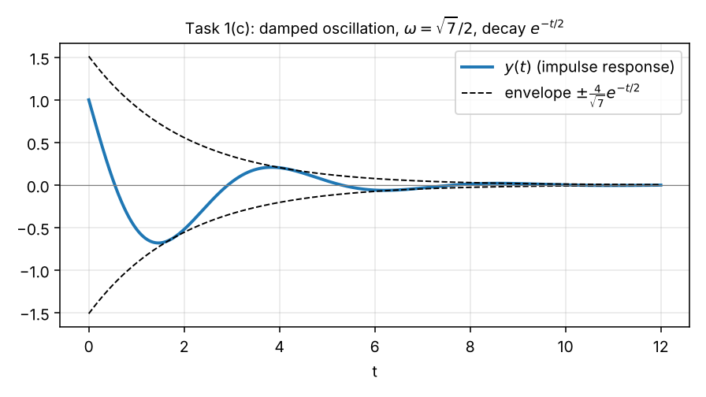
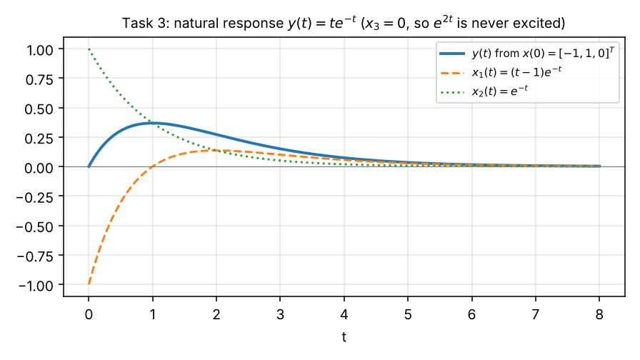
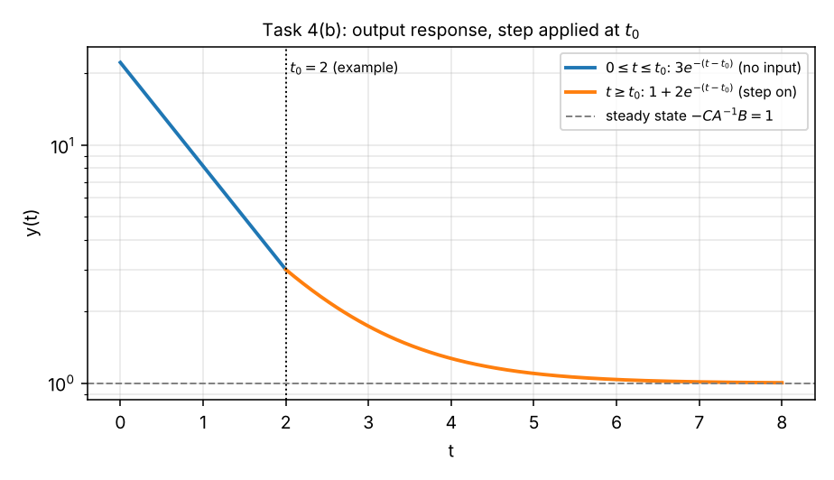

# Exercise 3 — Step-by-Step Solutions

**Course:** Advanced System Theory (Paderborn University, Automatic Control Group RAT, Prof. Dr. Erdal Kayacan)
**Covers:** Task 1 (a–c), Task 2, Task 3, Task 4 (a–b)
**Checking:** no official solution was available when this was written. Every result is verified by the scripts in [`python/`](python/) — symbolic algebra (SymPy: comparison with the exact matrix exponential) and numerical simulation (SciPy).

Every step is written out. References like "Concepts §7.4" point to [`concepts.md`](concepts.md). Notation as in the lecture: bold symbols are vectors/matrices, $\boldsymbol{\Phi}(t, t_0)$ is the state transition matrix, $\boldsymbol{P} = [\boldsymbol{p}_1\ \boldsymbol{p}_2]$ the eigenvector matrix with $\tilde{\boldsymbol{p}}_i$ the rows of $\boldsymbol{P}^{-1}$, $\alpha_k(t)$ the Cayley–Hamilton coefficients, $\sigma(t)$ the unit step, $\delta(t)$ the Dirac impulse, $j = \sqrt{-1}$.

---

## Contents

- [Task 1 — Modes and responses of LTI systems](#task-1--modes-and-responses-of-lti-systems)
- [Task 2 — Recovering the state transition matrix](#task-2--recovering-the-state-transition-matrix)
- [Task 3 — Determining initial conditions](#task-3--determining-initial-conditions)
- [Task 4 — Cayley–Hamilton method and response of LTI systems](#task-4--cayleyhamilton-method-and-response-of-lti-systems)
- [Summary of results](#summary-of-results)

---

## Task 1 — Modes and responses of LTI systems

$$
\dot{\boldsymbol{x}}(t) = \underbrace{\begin{bmatrix}0 & -2\\ 1 & -1\end{bmatrix}}_{\boldsymbol{A}}\boldsymbol{x}(t) + \underbrace{\begin{bmatrix}1\\ 1\end{bmatrix}}_{\boldsymbol{B}}u(t),\qquad
y(t) = \underbrace{\begin{bmatrix}1 & 0\end{bmatrix}}_{\boldsymbol{C}}\boldsymbol{x}(t),\qquad \boldsymbol{x}(0) = \begin{bmatrix}0\\ 0\end{bmatrix}.
$$

### 1(a) — State transition matrix by diagonalization

We use $e^{\boldsymbol{A}t} = \boldsymbol{P}e^{\boldsymbol{\Lambda}t}\boldsymbol{P}^{-1}$ (Concepts §7.1–7.2).

**Step 1 — Eigenvalues.**

$$
\det(\lambda\boldsymbol{I} - \boldsymbol{A}) = \det\begin{bmatrix}\lambda & 2\\ -1 & \lambda + 1\end{bmatrix} = \lambda(\lambda + 1) - (2)(-1) = \lambda^2 + \lambda + 2 = 0 .
$$

The discriminant $1 - 8 = -7$ is negative, so the roots are complex (Concepts §2.1):

$$
\lambda_{1,2} = \frac{-1\pm\sqrt{-7}}{2} = -\frac12\pm j\frac{\sqrt7}{2},\qquad \sigma = -\frac12,\quad \omega = \frac{\sqrt7}{2}\approx1.32 .
$$

*Check:* $\lambda_1 + \lambda_2 = -1 = \operatorname{tr}\boldsymbol{A}$ ✓, $\lambda_1\lambda_2 = \frac14 + \frac74 = 2 = \det\boldsymbol{A}$ ✓.

**Step 2 — Eigenvectors.** For $\lambda_1 = -\frac12 + j\frac{\sqrt7}{2}$:

$$
\lambda_1\boldsymbol{I} - \boldsymbol{A} = \begin{bmatrix}\lambda_1 & 2\\ -1 & \lambda_1 + 1\end{bmatrix}.
$$

The matrix is singular, so the second row suffices: $-p_{1} + (\lambda_1 + 1)p_{2} = 0$, i.e. $p_{1} = (\lambda_1 + 1)p_{2}$. With $p_{2} = 2$ (to avoid fractions) and $\lambda_1 + 1 = \frac12 + j\frac{\sqrt7}{2}$:

$$
\boldsymbol{p}_1 = \begin{bmatrix}1 + j\sqrt7\\ 2\end{bmatrix},\qquad \boldsymbol{p}_2 = \bar{\boldsymbol{p}}_1 = \begin{bmatrix}1 - j\sqrt7\\ 2\end{bmatrix}\quad(\text{for } \lambda_2 = \bar\lambda_1).
$$

*Check:* $\boldsymbol{A}\boldsymbol{p}_1 = \begin{bmatrix}-4\\ (1 + j\sqrt7) - 2\end{bmatrix} = \begin{bmatrix}-4\\ -1 + j\sqrt7\end{bmatrix}$ and $\lambda_1\boldsymbol{p}_1 = \frac{-1 + j\sqrt7}{2}\begin{bmatrix}1 + j\sqrt7\\ 2\end{bmatrix} = \begin{bmatrix}\frac{(-1 + j\sqrt7)(1 + j\sqrt7)}{2}\\ -1 + j\sqrt7\end{bmatrix} = \begin{bmatrix}\frac{-1 - 7}{2}\\ -1 + j\sqrt7\end{bmatrix} = \begin{bmatrix}-4\\ -1 + j\sqrt7\end{bmatrix}$ ✓.

**Step 3 — $\boldsymbol{P}$, $\boldsymbol{\Lambda}$ and $\boldsymbol{P}^{-1}$.**

$$
\boldsymbol{P} = \begin{bmatrix}1 + j\sqrt7 & 1 - j\sqrt7\\ 2 & 2\end{bmatrix},\qquad
\boldsymbol{\Lambda} = \begin{bmatrix}\lambda_1 & 0\\ 0 & \lambda_2\end{bmatrix},\qquad
\det\boldsymbol{P} = 2(1 + j\sqrt7) - 2(1 - j\sqrt7) = 4j\sqrt7 .
$$

With the 2×2 inverse formula and $\frac{1}{4j\sqrt7} = \frac{-j}{4\sqrt7}$:

$$
\boldsymbol{P}^{-1} = \frac{1}{4j\sqrt7}\begin{bmatrix}2 & -(1 - j\sqrt7)\\ -2 & 1 + j\sqrt7\end{bmatrix}
= \begin{bmatrix}\tilde{\boldsymbol{p}}_1\\ \tilde{\boldsymbol{p}}_2\end{bmatrix},\qquad
\tilde{\boldsymbol{p}}_1 = \begin{bmatrix}-\dfrac{j}{2\sqrt7} & \dfrac14 + \dfrac{j}{4\sqrt7}\end{bmatrix},\quad \tilde{\boldsymbol{p}}_2 = \bar{\tilde{\boldsymbol{p}}}_1 .
$$

($\tilde{\boldsymbol{p}}_1$: $\frac{-j}{4\sqrt7}\cdot2 = -\frac{j}{2\sqrt7}$ and $\frac{-j}{4\sqrt7}\cdot(-1 + j\sqrt7) = \frac{j + \sqrt7}{4\sqrt7} = \frac14 + \frac{j}{4\sqrt7}$.) *Check:* $\tilde{\boldsymbol{p}}_1\boldsymbol{p}_1 = -\frac{j(1 + j\sqrt7)}{2\sqrt7} + 2\big(\frac14 + \frac{j}{4\sqrt7}\big) = \frac{-j + \sqrt7}{2\sqrt7} + \frac12 + \frac{j}{2\sqrt7} = 1$ ✓.

**Step 4 — Multiply $\boldsymbol{P}e^{\boldsymbol{\Lambda}t}\boldsymbol{P}^{-1}$.** Column times row (Concepts §8.1):

$$
e^{\boldsymbol{A}t} = \boldsymbol{P}\begin{bmatrix}e^{\lambda_1t} & 0\\ 0 & e^{\lambda_2t}\end{bmatrix}\boldsymbol{P}^{-1} = \boldsymbol{p}_1\tilde{\boldsymbol{p}}_1e^{\lambda_1t} + \boldsymbol{p}_2\tilde{\boldsymbol{p}}_2e^{\lambda_2t}.
$$

The first mode matrix:

$$
\boldsymbol{M}_1 = \boldsymbol{p}_1\tilde{\boldsymbol{p}}_1 = \begin{bmatrix}(1 + j\sqrt7)\big(-\frac{j}{2\sqrt7}\big) & (1 + j\sqrt7)\big(\frac14 + \frac{j}{4\sqrt7}\big)\\ 2\big(-\frac{j}{2\sqrt7}\big) & 2\big(\frac14 + \frac{j}{4\sqrt7}\big)\end{bmatrix}
= \begin{bmatrix}\frac12 - \frac{j}{2\sqrt7} & \frac{2j}{\sqrt7}\\ -\frac{j}{\sqrt7} & \frac12 + \frac{j}{2\sqrt7}\end{bmatrix}
= \frac12\Big(\boldsymbol{I} + \frac{j}{\sqrt7}\boldsymbol{N}\Big),\quad \boldsymbol{N} = \begin{bmatrix}-1 & 4\\ -2 & 1\end{bmatrix}.
$$

(Top-left: $-\frac{j}{2\sqrt7} - \frac{j^2\sqrt7}{2\sqrt7} = \frac12 - \frac{j}{2\sqrt7}$. Top-right: $\frac14 + \frac{j}{4\sqrt7} + \frac{j\sqrt7}{4} + \frac{j^2}{4} = \frac{j}{4\sqrt7} + \frac{7j}{4\sqrt7} = \frac{2j}{\sqrt7}$.) Since everything in the second mode is the complex conjugate, $\boldsymbol{M}_2 = \bar{\boldsymbol{M}}_1$, and the sum of a number and its conjugate is twice its real part:

$$
e^{\boldsymbol{A}t} = \boldsymbol{M}_1e^{\lambda_1t} + \bar{\boldsymbol{M}}_1e^{\bar\lambda_1t} = 2\operatorname{Re}\Big[\boldsymbol{M}_1e^{\lambda_1t}\Big].
$$

With Euler, $e^{\lambda_1t} = e^{-t/2}\big(\cos\omega t + j\sin\omega t\big)$:

$$
2\operatorname{Re}\Big[\tfrac12\Big(\boldsymbol{I} + \tfrac{j}{\sqrt7}\boldsymbol{N}\Big)(\cos\omega t + j\sin\omega t)\Big]e^{-t/2}
= e^{-t/2}\Big[\cos(\omega t)\,\boldsymbol{I} - \frac{\sin(\omega t)}{\sqrt7}\boldsymbol{N}\Big]
$$

(the real part of $(1 + jb)(c + js)$ is $c - bs$). Writing out $-\boldsymbol{N}/\sqrt7$:

$$
\boxed{\;\boldsymbol{\Phi}(t, 0) = e^{\boldsymbol{A}t} = e^{-t/2}\begin{bmatrix}\cos\omega t + \frac{1}{\sqrt7}\sin\omega t & -\frac{4}{\sqrt7}\sin\omega t\\[3pt] \frac{2}{\sqrt7}\sin\omega t & \cos\omega t - \frac{1}{\sqrt7}\sin\omega t\end{bmatrix},\qquad \omega = \frac{\sqrt7}{2}\;}
$$

**Checks.**

- $t = 0$: $\cos0 = 1$, $\sin0 = 0$ ⇒ $\boldsymbol{\Phi}(0, 0) = \boldsymbol{I}$ ✓.
- Shortcut of Concepts §7.4 with $\sigma = -\frac12$, $\omega = \frac{\sqrt7}{2}$: $\frac{\boldsymbol{A} - \sigma\boldsymbol{I}}{\omega} = \frac{2\boldsymbol{A} + \boldsymbol{I}}{\sqrt7} = \frac{1}{\sqrt7}\begin{bmatrix}1 & -4\\ 2 & -1\end{bmatrix} = -\frac{\boldsymbol{N}}{\sqrt7}$ ✓ — same result.
- Derivative at $t = 0$: $-\frac12\boldsymbol{I} + \omega\cdot\frac{1}{\sqrt7}\begin{bmatrix}1 & -4\\ 2 & -1\end{bmatrix} = -\frac12\boldsymbol{I} + \frac12\begin{bmatrix}1 & -4\\ 2 & -1\end{bmatrix} = \begin{bmatrix}0 & -2\\ 1 & -1\end{bmatrix} = \boldsymbol{A}$ ✓.

### 1(b) — Sum of modes; which mode diverges?

From Step 4, with $\boldsymbol{M}_1 = \boldsymbol{p}_1\tilde{\boldsymbol{p}}_1$ and $\boldsymbol{M}_2 = \boldsymbol{p}_2\tilde{\boldsymbol{p}}_2$:

$$
\boxed{\;e^{\boldsymbol{A}t} = \underbrace{\frac12\Big(\boldsymbol{I} + \frac{j}{\sqrt7}\begin{bmatrix}-1 & 4\\ -2 & 1\end{bmatrix}\Big)}_{\boldsymbol{p}_1\tilde{\boldsymbol{p}}_1}e^{\left(-\frac12 + j\frac{\sqrt7}{2}\right)t} + \underbrace{\frac12\Big(\boldsymbol{I} - \frac{j}{\sqrt7}\begin{bmatrix}-1 & 4\\ -2 & 1\end{bmatrix}\Big)}_{\boldsymbol{p}_2\tilde{\boldsymbol{p}}_2}e^{\left(-\frac12 - j\frac{\sqrt7}{2}\right)t}\;}
$$

*Check:* $\boldsymbol{M}_1 + \boldsymbol{M}_2 = \boldsymbol{I}$ ✓ (the value at $t = 0$).

**Which mode diverges?** The size of each mode is set by the real part of its eigenvalue (Concepts §8.3):

$$
\lvert e^{\lambda_{1,2}t}\rvert = e^{\operatorname{Re}(\lambda_{1,2})\,t} = e^{-t/2}\ \xrightarrow{\ t\to\infty\ }\ 0 .
$$

**Neither mode diverges.** Both eigenvalues have real part $-\frac12 < 0$, so both modes are decaying oscillations with frequency $\omega = \frac{\sqrt7}{2}$ and envelope $e^{-t/2}$ (time constant 2 s). $e^{\boldsymbol{A}t}\to\boldsymbol{0}$ for every initial state, and the system is **(asymptotically) stable** — there is no instability.

*Remark.* The question suggests that one mode diverges; for the matrix given on the sheet this is not the case. A mode would introduce divergence only if $\operatorname{Re}\lambda_i > 0$. Because the eigenvalues form a conjugate pair with the **same** real part, here both modes would always decay or diverge together — e.g. if the bottom-right entry were $+1$ instead of $-1$, the characteristic polynomial would be $\lambda^2 - \lambda + 2$ with $\operatorname{Re}\lambda = +\frac12$, and both modes would diverge like $e^{t/2}$.

### 1(c) — Impulse response $u(t) = \delta(t)$

The initial state is zero, so the natural response vanishes and the **total response equals the forced response** (Concepts §12.2, $\boldsymbol{D} = 0$):

$$
y(t) = \underbrace{\boldsymbol{C}e^{\boldsymbol{A}t}\boldsymbol{x}(0)}_{=\,0} + \boldsymbol{C}\int_{0^-}^{t}e^{\boldsymbol{A}(t - \tau)}\boldsymbol{B}\,\delta(\tau)\,\mathrm{d}\tau .
$$

By the sifting property (Concepts §2.4) the integral picks out $\tau = 0$:

$$
\boldsymbol{x}(t) = e^{\boldsymbol{A}t}\boldsymbol{B},\qquad y(t) = \boldsymbol{C}e^{\boldsymbol{A}t}\boldsymbol{B} = H(t)\qquad(t\ge0).
$$

**State.** $e^{\boldsymbol{A}t}\boldsymbol{B}$ = sum of the two columns of $e^{\boldsymbol{A}t}$ (because $\boldsymbol{B} = [1, 1]^\top$):

$$
\boldsymbol{x}(t) = e^{-t/2}\begin{bmatrix}\cos\omega t + \frac{1}{\sqrt7}\sin\omega t - \frac{4}{\sqrt7}\sin\omega t\\[3pt] \frac{2}{\sqrt7}\sin\omega t + \cos\omega t - \frac{1}{\sqrt7}\sin\omega t\end{bmatrix}
= e^{-t/2}\begin{bmatrix}\cos\omega t - \frac{3}{\sqrt7}\sin\omega t\\[3pt] \cos\omega t + \frac{1}{\sqrt7}\sin\omega t\end{bmatrix}.
$$

**Output.** $\boldsymbol{C} = [1\ 0]$ picks the first component:

$$
\boxed{\;y(t) = \begin{cases}e^{-t/2}\Big(\cos\dfrac{\sqrt7}{2}t - \dfrac{3}{\sqrt7}\sin\dfrac{\sqrt7}{2}t\Big), & t\ge0\\[6pt] 0, & t < 0\end{cases}\;}
$$

**Checks and interpretation.**

- $y(0^+) = 1 = \boldsymbol{C}\boldsymbol{B}$ ✓: the impulse instantly sets the state to $\boldsymbol{x}(0^+) = \boldsymbol{B} = [1, 1]^\top$ (Concepts §13.2), and the sensor sees $x_1 = 1$.
- After the hit the system rings at $\omega = \frac{\sqrt7}{2}$ rad/s with a decaying envelope. In amplitude-phase form $y(t) = \frac{4}{\sqrt7}e^{-t/2}\cos(\omega t + \varphi)$ with $\tan\varphi = \frac{3}{\sqrt7}$ (amplitude $\sqrt{1 + 9/7} = 4/\sqrt7$).
- $y(t)\to0$, consistent with (b): the response to a hit dies out.

*Check:* `python/task1_modes_impulse.py` verifies $\boldsymbol{P}$, $\boldsymbol{P}^{-1}$, the mode matrices, $e^{\boldsymbol{A}t}$ against SymPy's exact matrix exponential, and $y(t)$ against `scipy.signal.impulse`.

---

## Task 2 — Recovering the state transition matrix

Given two trajectories of $\dot{\boldsymbol{x}} = \boldsymbol{A}\boldsymbol{x}$:

$$
\boldsymbol{x}^{(1)}(t) = \begin{bmatrix}4e^{-t} - 3e^{-2t}\\ -2e^{-t} + 3e^{-2t}\end{bmatrix}\ \text{ for }\ \boldsymbol{x}^{(1)}(0) = \begin{bmatrix}1\\ 1\end{bmatrix},\qquad
\boldsymbol{x}^{(2)}(t) = \begin{bmatrix}e^{-2t}\\ -e^{-2t}\end{bmatrix}\ \text{ for }\ \boldsymbol{x}^{(2)}(0) = \begin{bmatrix}1\\ -1\end{bmatrix}.
$$

Idea (Concepts §4.3, §15.1): every trajectory satisfies $\boldsymbol{x}(t) = \boldsymbol{\Phi}(t, 0)\boldsymbol{x}(0)$, so two trajectories with independent initial states determine $\boldsymbol{\Phi}$ completely.

**Step 1 — Check the initial states.** At $t = 0$: $\boldsymbol{x}^{(1)}(0) = [4 - 3,\ -2 + 3]^\top = [1, 1]^\top$ ✓ and $\boldsymbol{x}^{(2)}(0) = [1, -1]^\top$ ✓. They are linearly independent (not multiples of each other).

**Step 2 — Stack the trajectories.**

$$
\boldsymbol{X}(t) = \big[\boldsymbol{x}^{(1)}(t)\ \ \boldsymbol{x}^{(2)}(t)\big] = \begin{bmatrix}4e^{-t} - 3e^{-2t} & e^{-2t}\\ -2e^{-t} + 3e^{-2t} & -e^{-2t}\end{bmatrix},\qquad
\boldsymbol{X}_0 = \begin{bmatrix}1 & 1\\ 1 & -1\end{bmatrix},
$$

and $\boldsymbol{X}(t) = \boldsymbol{\Phi}(t, 0)\boldsymbol{X}_0$.

**Step 3 — Invert $\boldsymbol{X}_0$.** $\det\boldsymbol{X}_0 = -1 - 1 = -2$:

$$
\boldsymbol{X}_0^{-1} = \frac{1}{-2}\begin{bmatrix}-1 & -1\\ -1 & 1\end{bmatrix} = \frac12\begin{bmatrix}1 & 1\\ 1 & -1\end{bmatrix}.
$$

**Step 4 — $\boldsymbol{\Phi}(t, 0) = \boldsymbol{X}(t)\boldsymbol{X}_0^{-1}$.** Multiplying by $\frac12\begin{bmatrix}1 & 1\\ 1 & -1\end{bmatrix}$ means: first column = (col 1 + col 2)/2, second column = (col 1 − col 2)/2:

$$
\begin{aligned}
\text{row 1:}&\quad \tfrac12\big[(4e^{-t} - 3e^{-2t}) + e^{-2t}\big] = 2e^{-t} - e^{-2t},\qquad \tfrac12\big[(4e^{-t} - 3e^{-2t}) - e^{-2t}\big] = 2e^{-t} - 2e^{-2t}\\
\text{row 2:}&\quad \tfrac12\big[(-2e^{-t} + 3e^{-2t}) - e^{-2t}\big] = -e^{-t} + e^{-2t},\qquad \tfrac12\big[(-2e^{-t} + 3e^{-2t}) + e^{-2t}\big] = -e^{-t} + 2e^{-2t}
\end{aligned}
$$

$$
\boxed{\;\boldsymbol{\Phi}(t, 0) = \begin{bmatrix}2e^{-t} - e^{-2t} & 2e^{-t} - 2e^{-2t}\\ -e^{-t} + e^{-2t} & -e^{-t} + 2e^{-2t}\end{bmatrix}\;}
$$

*Check:* $\boldsymbol{\Phi}(0, 0) = \begin{bmatrix}2 - 1 & 2 - 2\\ -1 + 1 & -1 + 2\end{bmatrix} = \boldsymbol{I}$ ✓.

**Step 5 — $\boldsymbol{A} = \dot{\boldsymbol{\Phi}}(t, 0)\big|_{t = 0}$** (Definition 1.2 at $t = t_0$):

$$
\dot{\boldsymbol{\Phi}}(t, 0) = \begin{bmatrix}-2e^{-t} + 2e^{-2t} & -2e^{-t} + 4e^{-2t}\\ e^{-t} - 2e^{-2t} & e^{-t} - 4e^{-2t}\end{bmatrix}
\ \xrightarrow{\ t = 0\ }\
\boxed{\;\boldsymbol{A} = \begin{bmatrix}0 & 2\\ -1 & -3\end{bmatrix}\;}
$$

**Checks.**

- Eigenvalues of $\boldsymbol{A}$: $\lambda^2 + 3\lambda + 2 = (\lambda + 1)(\lambda + 2)$ ⇒ $-1, -2$ — exactly the exponentials $e^{-t}$, $e^{-2t}$ in the data ✓.
- Eigenvector of $-2$: $(-2\boldsymbol{I} - \boldsymbol{A})\boldsymbol{v} = \begin{bmatrix}-2 & -2\\ 1 & 1\end{bmatrix}\boldsymbol{v} = \boldsymbol{0}$ ⇒ $\boldsymbol{v} = [1, -1]^\top$. That is $\boldsymbol{x}^{(2)}(0)$, which explains why the second trajectory contains **only** $e^{-2t}$ — it is a pure mode (Concepts §8.2) ✓.
- Second trajectory: $\boldsymbol{A}\begin{bmatrix}e^{-2t}\\ -e^{-2t}\end{bmatrix} = \begin{bmatrix}-2e^{-2t}\\ -e^{-2t} + 3e^{-2t}\end{bmatrix} = \begin{bmatrix}-2e^{-2t}\\ 2e^{-2t}\end{bmatrix} = \dot{\boldsymbol{x}}^{(2)}$ ✓.
- $\dot{\boldsymbol{\Phi}} = \boldsymbol{A}\boldsymbol{\Phi}$ for all $t$, and $e^{\boldsymbol{A}t}$ computed from $\boldsymbol{A}$ equals $\boldsymbol{\Phi}$ (script) ✓.

*Check:* `python/task2_recover_A.py` (symbolic), plus a simulation of $\dot{\boldsymbol{x}} = \boldsymbol{A}\boldsymbol{x}$ with the recovered $\boldsymbol{A}$ that reproduces both given trajectories.

---

## Task 3 — Determining initial conditions

$$
\boldsymbol{A} = \begin{bmatrix}-1 & 1 & 0\\ 0 & -1 & 0\\ 0 & 0 & 2\end{bmatrix},\qquad \boldsymbol{C} = \begin{bmatrix}1 & 1 & 1\end{bmatrix},\qquad \text{wanted: } \boldsymbol{x}(0)\ \text{such that}\ y(t) = te^{-t},\ t\ge0 .
$$

Approach: compute $y(t) = \boldsymbol{C}e^{\boldsymbol{A}t}\boldsymbol{x}(0)$ for unknown $\boldsymbol{x}(0)$, then match coefficients (Concepts §15.2).

**Step 1 — Structure of $\boldsymbol{A}$.** $\boldsymbol{A}$ is block-diagonal: a 2×2 **Jordan block** for $\lambda = -1$ (upper-left) and a 1×1 block $\lambda = 2$ (lower-right). It is already in Jordan form (Concepts §9), so exponentiate block by block (Concepts §5.2):

$$
\exp\!\left(\begin{bmatrix}-1 & 1\\ 0 & -1\end{bmatrix}t\right) = e^{-t}\begin{bmatrix}1 & t\\ 0 & 1\end{bmatrix},\qquad e^{2t}\ \text{for the last state}.
$$

(The block is $-\boldsymbol{I} + \boldsymbol{N}$ with $\boldsymbol{N} = \begin{bmatrix}0 & 1\\ 0 & 0\end{bmatrix}$, $\boldsymbol{N}^2 = \boldsymbol{0}$, so $e^{(-\boldsymbol{I} + \boldsymbol{N})t} = e^{-t}(\boldsymbol{I} + \boldsymbol{N}t)$.)

$$
e^{\boldsymbol{A}t} = \begin{bmatrix}e^{-t} & te^{-t} & 0\\ 0 & e^{-t} & 0\\ 0 & 0 & e^{2t}\end{bmatrix}.
$$

**Step 2 — Natural response for $\boldsymbol{x}(0) = [a, b, c]^\top$.**

$$
\boldsymbol{x}(t) = e^{\boldsymbol{A}t}\boldsymbol{x}(0) = \begin{bmatrix}ae^{-t} + bte^{-t}\\ be^{-t}\\ ce^{2t}\end{bmatrix},\qquad
y(t) = x_1 + x_2 + x_3 = (a + b)\,e^{-t} + b\,te^{-t} + c\,e^{2t}.
$$

**Step 3 — Match coefficients** with $y(t) = 0\cdot e^{-t} + 1\cdot te^{-t} + 0\cdot e^{2t}$. The functions $e^{-t}$, $te^{-t}$, $e^{2t}$ are linearly independent (Concepts §2.3), so each coefficient must agree:

| Function | Coefficient in $y(t)$ | Required | Equation |
|---|---|---|---|
| $te^{-t}$ | $b$ | $1$ | $b = 1$ |
| $e^{-t}$ | $a + b$ | $0$ | $a = -b = -1$ |
| $e^{2t}$ | $c$ | $0$ | $c = 0$ |

$$
\boxed{\;\boldsymbol{x}(0) = \begin{bmatrix}-1\\ 1\\ 0\end{bmatrix}\;}
$$

The solution is **unique** — three independent equations for three unknowns.

**Check.** $\boldsymbol{x}(t) = [(t - 1)e^{-t},\ e^{-t},\ 0]^\top$, so $y(t) = (t - 1)e^{-t} + e^{-t} + 0 = te^{-t}$ ✓.

**Interpretation.**

- A term $te^{-t}$ can appear only because $\boldsymbol{A}$ has a **Jordan block** for $\lambda = -1$ (Concepts §9.2) — a diagonalizable $\boldsymbol{A}$ could never produce it.
- $c = 0$ is forced: $x_3$ carries the **unstable mode $e^{2t}$**, and since $\boldsymbol{C}$ sees $x_3$, any $c\ne0$ would make $y(t)$ blow up. The chosen initial state does not excite the unstable mode — but the system itself is unstable, and the smallest error in $x_3(0)$ would eventually dominate.
- $a = -1$ cancels the $e^{-t}$ that $x_2$ adds to the output, leaving only $te^{-t}$.

*Check:* `python/task3_initial_condition.py` (symbolic + simulation).

---

## Task 4 — Cayley–Hamilton method and response of LTI systems

$$
\dot{\boldsymbol{x}} = \underbrace{\begin{bmatrix}-6 & -1\\ 5 & 0\end{bmatrix}}_{\boldsymbol{A}}\boldsymbol{x} + \underbrace{\begin{bmatrix}1\\ 0\end{bmatrix}}_{\boldsymbol{B}}u,\qquad
y = \underbrace{\begin{bmatrix}1 & 1\end{bmatrix}}_{\boldsymbol{C}}\boldsymbol{x},\qquad
\boldsymbol{x}(t_0) = \begin{bmatrix}1\\ 2\end{bmatrix}\ (t_0 > 0),\qquad u(t) = \sigma(t - t_0).
$$

### 4(a) — $e^{\boldsymbol{A}t}$ with Cayley–Hamilton

**Step 1 — Eigenvalues.**

$$
\det(\lambda\boldsymbol{I} - \boldsymbol{A}) = \det\begin{bmatrix}\lambda + 6 & 1\\ -5 & \lambda\end{bmatrix} = \lambda(\lambda + 6) + 5 = \lambda^2 + 6\lambda + 5 = (\lambda + 1)(\lambda + 5) = 0
\ \Longrightarrow\ \lambda_1 = -1,\quad \lambda_2 = -5 .
$$

Distinct, so the Vandermonde matrix is invertible (Concepts §10.2). (Cayley–Hamilton itself: $\boldsymbol{A}^2 + 6\boldsymbol{A} + 5\boldsymbol{I} = \boldsymbol{0}$, verified in Concepts §10.1.)

**Step 2 — Ansatz.** $n = 2$, so

$$
e^{\boldsymbol{A}t} = \alpha_0(t)\boldsymbol{I} + \alpha_1(t)\boldsymbol{A}.
$$

**Step 3 — One scalar equation per eigenvalue** ($e^{\lambda_it} = \alpha_0 + \alpha_1\lambda_i$):

$$
\begin{bmatrix}e^{-t}\\ e^{-5t}\end{bmatrix} = \underbrace{\begin{bmatrix}1 & -1\\ 1 & -5\end{bmatrix}}_{\boldsymbol{V}}\begin{bmatrix}\alpha_0(t)\\ \alpha_1(t)\end{bmatrix}
\quad\Longleftrightarrow\quad
\begin{cases}e^{-t} = \alpha_0 - \alpha_1\\ e^{-5t} = \alpha_0 - 5\alpha_1\end{cases}
$$

**Step 4 — Solve.** Subtract the second equation from the first: $e^{-t} - e^{-5t} = 4\alpha_1$, then $\alpha_0 = e^{-t} + \alpha_1$:

$$
\boxed{\;\alpha_1(t) = \frac{e^{-t} - e^{-5t}}{4},\qquad \alpha_0(t) = \frac{5e^{-t} - e^{-5t}}{4}\;}
$$

(Same as the general 2×2 formula of Concepts §10.2.) *Check $t = 0$:* $\alpha_0 = 1$, $\alpha_1 = 0$ ⇒ $e^{\boldsymbol{A}\cdot0} = \boldsymbol{I}$ ✓.

**Step 5 — Insert.**

$$
e^{\boldsymbol{A}t} = \frac{5e^{-t} - e^{-5t}}{4}\begin{bmatrix}1 & 0\\ 0 & 1\end{bmatrix} + \frac{e^{-t} - e^{-5t}}{4}\begin{bmatrix}-6 & -1\\ 5 & 0\end{bmatrix}.
$$

Entry by entry (everything over 4):

- (1,1): $5e^{-t} - e^{-5t} - 6e^{-t} + 6e^{-5t} = -e^{-t} + 5e^{-5t}$
- (1,2): $-(e^{-t} - e^{-5t}) = -e^{-t} + e^{-5t}$
- (2,1): $5(e^{-t} - e^{-5t}) = 5e^{-t} - 5e^{-5t}$
- (2,2): $5e^{-t} - e^{-5t} + 0 = 5e^{-t} - e^{-5t}$

$$
\boxed{\;e^{\boldsymbol{A}t} = \frac14\begin{bmatrix}-e^{-t} + 5e^{-5t} & -e^{-t} + e^{-5t}\\ 5e^{-t} - 5e^{-5t} & 5e^{-t} - e^{-5t}\end{bmatrix}\;}
$$

*Checks:* $t = 0$: $\frac14\begin{bmatrix}4 & 0\\ 0 & 4\end{bmatrix} = \boldsymbol{I}$ ✓. Derivative at $t = 0$: $\frac14\begin{bmatrix}1 - 25 & 1 - 5\\ -5 + 25 & -5 + 5\end{bmatrix} = \begin{bmatrix}-6 & -1\\ 5 & 0\end{bmatrix} = \boldsymbol{A}$ ✓.

### 4(b) — Response $y(t)$ for $t\ge0$

The state is given at $t_0 > 0$ and the step switches on at $t_0$. With $\boldsymbol{\Phi}(t, t_0) = e^{\boldsymbol{A}(t - t_0)}$ the total response is (Concepts §12.2)

$$
y(t) = \boldsymbol{C}e^{\boldsymbol{A}(t - t_0)}\boldsymbol{x}(t_0) + \boldsymbol{C}\int_{t_0}^{t}e^{\boldsymbol{A}(t - \tau)}\boldsymbol{B}\,\sigma(\tau - t_0)\,\mathrm{d}\tau .
$$

Write $\tau_0 := t - t_0$ for the time elapsed since $t_0$ (negative for $t < t_0$).

**Step 1 — Natural part (valid for all $t$).**

$$
e^{\boldsymbol{A}\tau_0}\boldsymbol{x}(t_0) = \frac14\begin{bmatrix}(-e^{-\tau_0} + 5e^{-5\tau_0}) + 2(-e^{-\tau_0} + e^{-5\tau_0})\\ (5e^{-\tau_0} - 5e^{-5\tau_0}) + 2(5e^{-\tau_0} - e^{-5\tau_0})\end{bmatrix} = \frac14\begin{bmatrix}-3e^{-\tau_0} + 7e^{-5\tau_0}\\ 15e^{-\tau_0} - 7e^{-5\tau_0}\end{bmatrix},
$$

$$
y_h(t) = \boldsymbol{C}e^{\boldsymbol{A}\tau_0}\boldsymbol{x}(t_0) = \frac14\big(12e^{-\tau_0} + 0\cdot e^{-5\tau_0}\big) = 3e^{-(t - t_0)} .
$$

The $e^{-5t}$ terms **cancel in the output**. Reason: the eigenvector of $\lambda_2 = -5$ is $\boldsymbol{v}_2 = [1, -1]^\top$ (from $(-5\boldsymbol{I} - \boldsymbol{A})\boldsymbol{v} = \begin{bmatrix}1 & 1\\ -5 & -5\end{bmatrix}\boldsymbol{v} = \boldsymbol{0}$), and $\boldsymbol{C}\boldsymbol{v}_2 = 1 - 1 = 0$: the sensor cannot see the fast mode at all. (Week 12 calls this *unobservable*.)

**Step 2 — Case $0\le t\le t_0$.** Here $\sigma(t - t_0) = 0$ — no input yet, and the forced integral is empty. The state is known at $t_0$, so it is propagated **backwards** with $\boldsymbol{\Phi}(t, t_0) = e^{\boldsymbol{A}(t - t_0)}$, $t - t_0\le0$ (Concepts §4.2, $\boldsymbol{\Phi}(t, t_0)^{-1} = \boldsymbol{\Phi}(t_0, t)$):

$$
\boxed{\;y(t) = 3e^{-(t - t_0)} = 3e^{t_0 - t},\qquad 0\le t\le t_0\;}
$$

At $t = 0$: $y(0) = 3e^{t_0}$. The output was **larger** in the past and has been decaying towards the value 3 that it reaches at $t_0$.

**Step 3 — Forced part for $t\ge t_0$.** For $\tau\ge t_0$ the input is $1$, so (Concepts §13.3, $\boldsymbol{A}$ invertible since $\det\boldsymbol{A} = 5\ne0$):

$$
\boldsymbol{x}_p(t) = \int_{t_0}^{t}e^{\boldsymbol{A}(t - \tau)}\boldsymbol{B}\,\mathrm{d}\tau = \boldsymbol{A}^{-1}\big(e^{\boldsymbol{A}\tau_0} - \boldsymbol{I}\big)\boldsymbol{B},\qquad
\boldsymbol{A}^{-1} = \frac15\begin{bmatrix}0 & 1\\ -5 & -6\end{bmatrix} = \begin{bmatrix}0 & \frac15\\ -1 & -\frac65\end{bmatrix}.
$$

- $\boldsymbol{A}^{-1}\boldsymbol{B} = [0,\ -1]^\top$ (first column of $\boldsymbol{A}^{-1}$).
- $e^{\boldsymbol{A}\tau_0}\boldsymbol{B}$ = first column of $e^{\boldsymbol{A}\tau_0}$ $= \frac14[-e^{-\tau_0} + 5e^{-5\tau_0},\ 5e^{-\tau_0} - 5e^{-5\tau_0}]^\top$.
- $\boldsymbol{A}^{-1}e^{\boldsymbol{A}\tau_0}\boldsymbol{B}$: first row $\frac15\cdot\frac14(5e^{-\tau_0} - 5e^{-5\tau_0}) = \frac14(e^{-\tau_0} - e^{-5\tau_0})$; second row $\frac14\big[(e^{-\tau_0} - 5e^{-5\tau_0}) - \frac65(5e^{-\tau_0} - 5e^{-5\tau_0})\big] = \frac14(-5e^{-\tau_0} + e^{-5\tau_0})$.

$$
\boldsymbol{x}_p(t) = \frac14\begin{bmatrix}e^{-\tau_0} - e^{-5\tau_0}\\ -5e^{-\tau_0} + e^{-5\tau_0}\end{bmatrix} - \begin{bmatrix}0\\ -1\end{bmatrix} = \begin{bmatrix}\frac14(e^{-\tau_0} - e^{-5\tau_0})\\ 1 + \frac14(-5e^{-\tau_0} + e^{-5\tau_0})\end{bmatrix},\qquad
y_p(t) = \boldsymbol{C}\boldsymbol{x}_p = 1 - e^{-(t - t_0)} .
$$

Again the $e^{-5\tau_0}$ terms cancel in $y$.

**Step 4 — Total response for $t\ge t_0$.**

$$
\boxed{\;y(t) = \underbrace{3e^{-(t - t_0)}}_{\text{natural}} + \underbrace{1 - e^{-(t - t_0)}}_{\text{forced}} = 1 + 2e^{-(t - t_0)},\qquad t\ge t_0\;}
$$

For completeness, the state: $\boldsymbol{x}(t) = \big[-\frac12e^{-\tau_0} + \frac32e^{-5\tau_0},\ \ 1 + \frac52e^{-\tau_0} - \frac32e^{-5\tau_0}\big]^\top$ ($t\ge t_0$), which gives $[1, 2]^\top$ at $\tau_0 = 0$ ✓.

**Summary of (b):**

$$
y(t) = \begin{cases}3e^{-(t - t_0)}, & 0\le t\le t_0\\[3pt] 1 + 2e^{-(t - t_0)}, & t\ge t_0\end{cases}
$$

**Checks.**

- **Continuity at $t_0$:** both branches give $y(t_0) = 3 = \boldsymbol{C}\boldsymbol{x}(t_0) = 1 + 2$ ✓ (no feedthrough, $\boldsymbol{D} = 0$, so a step cannot make $y$ jump).
- **Steady state:** $y(\infty) = -\boldsymbol{C}\boldsymbol{A}^{-1}\boldsymbol{B} = -[1\ 1][0, -1]^\top = 1$ ✓ — both eigenvalues are negative, so the response settles.
- **Time invariance:** the result depends only on $t - t_0$ — the step response at $t_0$ is the step response at $0$ shifted by $t_0$.

*Check:* `python/task4_cayley_hamilton.py` verifies the $\alpha_k$, $e^{\boldsymbol{A}t}$, both branches symbolically, and simulates the system backwards from $t_0$ to $0$ and forwards from $t_0$ (example $t_0 = 2$):

---

## Summary of results

- **Task 1:** $\lambda_{1,2} = -\frac12\pm j\frac{\sqrt7}{2}$; $e^{\boldsymbol{A}t} = e^{-t/2}\begin{bmatrix}\cos\omega t + \frac{1}{\sqrt7}\sin\omega t & -\frac{4}{\sqrt7}\sin\omega t\\ \frac{2}{\sqrt7}\sin\omega t & \cos\omega t - \frac{1}{\sqrt7}\sin\omega t\end{bmatrix}$, $\omega = \frac{\sqrt7}{2}$; modes $\boldsymbol{p}_i\tilde{\boldsymbol{p}}_ie^{\lambda_it}$ with $\boldsymbol{p}_1\tilde{\boldsymbol{p}}_1 = \frac12(\boldsymbol{I} + \frac{j}{\sqrt7}\boldsymbol{N})$; **no mode diverges** ($\operatorname{Re}\lambda = -\frac12$); impulse response $y(t) = e^{-t/2}\big(\cos\omega t - \frac{3}{\sqrt7}\sin\omega t\big)$, $t\ge0$.
- **Task 2:** $\boldsymbol{\Phi}(t, 0) = \begin{bmatrix}2e^{-t} - e^{-2t} & 2e^{-t} - 2e^{-2t}\\ -e^{-t} + e^{-2t} & -e^{-t} + 2e^{-2t}\end{bmatrix}$, $\boldsymbol{A} = \begin{bmatrix}0 & 2\\ -1 & -3\end{bmatrix}$.
- **Task 3:** $\boldsymbol{x}(0) = [-1,\ 1,\ 0]^\top$ (unique).
- **Task 4:** $\alpha_0 = \frac{5e^{-t} - e^{-5t}}{4}$, $\alpha_1 = \frac{e^{-t} - e^{-5t}}{4}$, $e^{\boldsymbol{A}t} = \frac14\begin{bmatrix}-e^{-t} + 5e^{-5t} & -e^{-t} + e^{-5t}\\ 5e^{-t} - 5e^{-5t} & 5e^{-t} - e^{-5t}\end{bmatrix}$; $y(t) = 3e^{-(t - t_0)}$ for $0\le t\le t_0$, $y(t) = 1 + 2e^{-(t - t_0)}$ for $t\ge t_0$.
