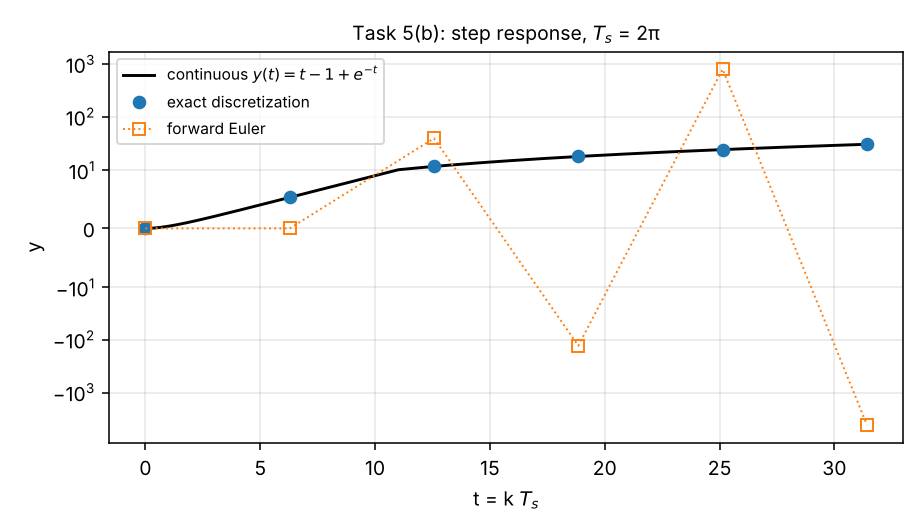

# Exercise 4 — Discrete-Time Systems and Discretization

Lecture: Week 04 — Discrete-time systems and discretization. Problem sheet: Exercise 4 (keep a local copy in [`../course-material/`](../course-material/); it is not published here).

## Files

| File | What it contains |
|---|---|
| [`concepts.md`](concepts.md) · [PDF](pdf/concepts.pdf) | Intuitive overview (why discrete time, continuous ↔ discrete dictionary, topic-by-topic intuition), sampling and zero-order hold, difference equations, state transition matrix $\boldsymbol{A}^{k-k_0}$, computing $\boldsymbol{A}^k$, modes and $\lvert\lambda\rvert<1$, convolution sum, impulse and step response (geometric series, fixed point), reachability, exact discretization (incl. singular $\boldsymbol{A}$), forward Euler and its stability limit, the lecture example, choosing $T_s$, cheat sheet |
| [`solutions.md`](solutions.md) · [PDF](pdf/solutions.pdf) | Tasks 1–5, fully worked |
| [`python/lecture_examples.py`](python/lecture_examples.py) | All slide examples checked (slides 10, 13, 22–30) + continuous vs exact vs Euler figure |
| [`python/task1_discrete_response.py`](python/task1_discrete_response.py) | Task 1: iteration, closed form, periodic output |
| [`python/task2_reachability.py`](python/task2_reachability.py) | Task 2: Cayley–Hamilton, reachability matrix, input sequence, counterexample |
| [`python/task3_discrete_responses.py`](python/task3_discrete_responses.py) | Task 3: impulse/step responses of both systems |
| [`python/task4_discretization.py`](python/task4_discretization.py) | Task 4: exact and Euler matrices, checked against `scipy.signal.cont2discrete` |
| [`python/task5_discretization.py`](python/task5_discretization.py) | Task 5: discretization and step-response plots for $T_s = 0.5$ and $2\pi$ |

Run any script with `python python/<name>.py` (needs `numpy scipy matplotlib sympy`).

## Progress

- [x] Week 4 concepts
- [x] Task 1 — Response of discrete systems
- [x] Task 2 — Reachable states
- [x] Task 3 — Response of discrete systems 2
- [x] Task 4 — Discretization
- [x] Task 5 — Discretization 2

## Key results

- **Task 1:** $\boldsymbol{x}[1..3] = [0,0]^\top, [1,1]^\top, [2,0]^\top$; $y[k] = 1 - \sin(k\pi/2)$ (period 4).
- **Task 2:** $u[0] = 12/13$, $u[1] = 28/13$; $n$ steps suffice from $\boldsymbol{x}[0] = \boldsymbol{0}$ (Cayley–Hamilton), not in general from $\boldsymbol{x}[0]\ne\boldsymbol{0}$.
- **Task 3:** both systems share $H[k] = (-1)^{k-1} - (-2)^{k-1}$; all responses diverge (eigenvalue $-2$).
- **Task 4/5:** exact $\boldsymbol{A}_d = e^{\boldsymbol{A}T_s}$, $\boldsymbol{B}_d = \int_0^{T_s}e^{\boldsymbol{A}\alpha}\mathrm{d}\alpha\,\boldsymbol{B}$ (singular $\boldsymbol{A}$); Euler for Task 5 is unstable at $T_s = 2\pi$.

