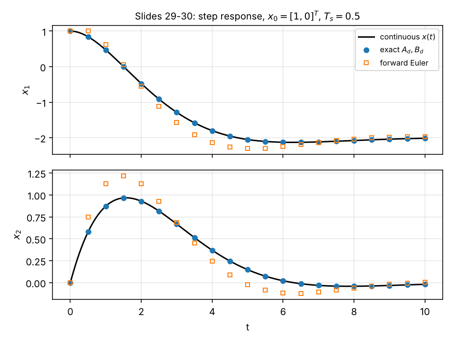

# Exercise 4 — Concepts

**Course:** Advanced System Theory (Paderborn University, Automatic Control Group RAT, Prof. Dr. Erdal Kayacan), winter semester 2026/27
**Lecture:** Week 04 — Discrete-time systems and discretization
**Covers:** everything needed for Exercise 4 — Task 1 (response of a discrete system), Task 2 (reachable states), Task 3 (impulse and step responses), Task 4 (exact and forward-Euler discretization), Task 5 (discretization and the effect of the sampling time)

This sheet starts with the **intuition** — why we need discrete time at all and how the pieces of the lecture fit together — then builds every tool from the ground up, each as a recipe with a worked example. The full solutions are in [`solutions.md`](solutions.md); the scripts in [`python/`](python/) check every number.

**Notation (as in the lecture slides).** Bold symbols are vectors and matrices. Discrete time $k\in\mathbb{Z}$ with square brackets: $\boldsymbol{x}[k]$, $\boldsymbol{u}[k]$, $\boldsymbol{y}[k]$, initial index $k_0$, $\boldsymbol{x}_0 = \boldsymbol{x}[k_0]$. $\boldsymbol{\Phi}[k, k_0]$ is the discrete-time state transition matrix, $\boldsymbol{H}[k]$ the impulse response matrix, $\sigma[k]$ the unit step, $\delta[k]$ the unit impulse. $T_s$ is the sampling interval, $t_k = kT_s$ the sampling instants. $\boldsymbol{A}_d$, $\boldsymbol{B}_d$, $\boldsymbol{\Phi}_d$ mark the discrete-time matrices obtained by discretizing a continuous model ($\boldsymbol{A}$, $\boldsymbol{B}$); a tilde ($\tilde{\boldsymbol{A}}_d$, $\tilde{\boldsymbol{B}}_d$) marks the forward-Euler approximation.

---

## Contents

0. [The big picture: what this lecture is about](#0-the-big-picture-what-this-lecture-is-about)
1. [Sampling and zero-order hold](#1-sampling-and-zero-order-hold)
2. [Discrete-time state-space models](#2-discrete-time-state-space-models)
3. [Homogeneous solution and the state transition matrix](#3-homogeneous-solution-and-the-state-transition-matrix)
4. [Computing $\boldsymbol{A}^k$ and reading the modes](#4-computing-ak-and-reading-the-modes)
5. [Non-homogeneous solution and total response](#5-non-homogeneous-solution-and-total-response)
6. [Impulse response and step response in discrete time](#6-impulse-response-and-step-response-in-discrete-time)
7. [Reachable states (needed for Task 2)](#7-reachable-states-needed-for-task-2)
8. [Exact discretization](#8-exact-discretization)
9. [Forward Euler approximation](#9-forward-euler-approximation)
10. [Worked lecture example: discretization](#10-worked-lecture-example-discretization)
11. [Choosing the sampling time](#11-choosing-the-sampling-time)
12. [Cheat sheet](#12-cheat-sheet)

---

## 0. The big picture: what this lecture is about

### 0.1 Why discrete time?

Real physical systems — a motor, a drone, a chemical tank — evolve **continuously** in time. But the controller that runs them is almost always a **computer**: a microcontroller that wakes up every $T_s$ seconds, **reads** the sensors (A/D conversion), **computes** a new input, **writes** it to the actuators (D/A conversion), and goes back to sleep (slide 5, Fig. 1.1).

So the computer never sees the smooth signal $y(t)$; it sees a **list of numbers** $y[0], y[1], y[2],\dots$ taken at $t = 0, T_s, 2T_s,\dots$ And it does not produce a smooth input $u(t)$; it produces a list $u[0], u[1],\dots$ that the D/A converter holds constant between updates.

From the computer's point of view, the plant **is** a discrete-time system: numbers in, numbers out, one step at a time. Discrete-time models also appear in signal and image processing (digital filters), communications, and every numerical simulation (slide 6).

### 0.2 The two questions of this lecture

| Question | Answer in the lecture | Week 3 analogue |
|---|---|---|
| **1. Given a discrete model, what is its response?** | iterate $\boldsymbol{x}[k+1] = \boldsymbol{A}\boldsymbol{x}[k] + \boldsymbol{B}\boldsymbol{u}[k]$; closed form $\boldsymbol{x}[k] = \boldsymbol{A}^k\boldsymbol{x}_0 + \sum\boldsymbol{A}^{k-1-j}\boldsymbol{B}\boldsymbol{u}[j]$ | $\boldsymbol{x}(t) = e^{\boldsymbol{A}t}\boldsymbol{x}_0 + \int e^{\boldsymbol{A}(t-\tau)}\boldsymbol{B}\boldsymbol{u}\,\mathrm{d}\tau$ |
| **2. Given a continuous model, which discrete model describes it at the sampling instants?** | exact: $\boldsymbol{A}_d = e^{\boldsymbol{A}T_s}$, $\boldsymbol{B}_d = \int_0^{T_s}e^{\boldsymbol{A}\alpha}\mathrm{d}\alpha\,\boldsymbol{B}$; approximate (Euler): $\tilde{\boldsymbol{A}}_d = \boldsymbol{I} + T_s\boldsymbol{A}$, $\tilde{\boldsymbol{B}}_d = T_s\boldsymbol{B}$ | — |

**Everything from Week 3 has a discrete twin** — and the discrete version is *easier*, because there are no integrals, only sums and powers:

| Continuous time (Week 3) | Discrete time (Week 4) |
|---|---|
| $\dot{\boldsymbol{x}} = \boldsymbol{A}\boldsymbol{x} + \boldsymbol{B}\boldsymbol{u}$ (rate of change) | $\boldsymbol{x}[k+1] = \boldsymbol{A}\boldsymbol{x}[k] + \boldsymbol{B}\boldsymbol{u}[k]$ (next value) |
| $\boldsymbol{\Phi}(t, t_0) = e^{\boldsymbol{A}(t - t_0)}$ | $\boldsymbol{\Phi}[k, k_0] = \boldsymbol{A}^{k - k_0}$ |
| convolution integral $\int_0^t$ | convolution sum $\sum_{j=0}^{k-1}$ |
| modes $e^{\lambda t}$ | modes $\lambda^k$ |
| stable mode: $\operatorname{Re}\lambda < 0$ | stable mode: $\lvert\lambda\rvert < 1$ |
| impulse response $\boldsymbol{C}e^{\boldsymbol{A}t}\boldsymbol{B} + \boldsymbol{D}\delta(t)$ | impulse response $\boldsymbol{C}\boldsymbol{A}^{k-1}\boldsymbol{B}$ ($k > 0$), $\boldsymbol{D}$ ($k = 0$) |

### 0.3 The lecture topic by topic, in one line each

| Topic | Intuition | Section |
|---|---|---|
| Zero-order hold, sampling | the computer holds each input value constant for one step and reads the output once per step | 1 |
| Difference equation | a recipe you can run: the next state from the current state and input | 2 |
| State transition matrix $\boldsymbol{A}^{k - k_0}$ | "apply $\boldsymbol{A}$ once per step" — the discrete time machine | 3 |
| Modes $\lambda^k$ | each eigen-direction is multiplied by $\lambda$ every step: shrinks if $\lvert\lambda\rvert < 1$, grows if $> 1$, flips sign if $\lambda < 0$ | 4 |
| Convolution sum | the input given $i$ steps ago has been multiplied by $\boldsymbol{A}$ exactly $i$ times by now | 5 |
| Impulse response $\boldsymbol{H}[k]$ | kick the system once and record the output — every other response follows from it | 6 |
| Reachability (exercise) | which states can the input steer the system to, and how many steps does it take? | 7 |
| Exact discretization | choose $\boldsymbol{A}_d$, $\boldsymbol{B}_d$ so the discrete model hits the continuous trajectory **exactly** at every sample | 8 |
| Forward Euler | the cheap shortcut "new = old + $T_s\cdot$slope" — accurate for small $T_s$, can even become unstable for large $T_s$ | 9 |

### 0.4 Which section is needed for which task?

| Exercise task | Needs |
|---|---|
| Task 1 response of a discrete system | §2, §3, §4 (rotation matrix, periodicity), §5, §6.3 (step input, fixed point) |
| Task 2 reachable states | §7 (and Cayley–Hamilton from Week 3) |
| Task 3 impulse and step responses | §4.2 (diagonalization), §5, §6 |
| Task 4 exact and Euler discretization | §8 (incl. §8.4 singular $\boldsymbol{A}$), §9 |
| Task 5 discretization, effect of $T_s$ | §8, §9, §9.3 (Euler stability), §11 |

---

## 1. Sampling and zero-order hold

### 1.1 The idealised computer interface (slide 7)

Assume ideal **zero-order hold** (ZOH) D/A conversion and ideal A/D conversion:

$$
u(t) = u[k],\quad t_k\le t < t_{k+1},\qquad\qquad y[k] = y(t_k),\qquad k\in\lbrace\mathbb{Z}\mid k\ge k_0\rbrace .
$$

- **ZOH (D/A):** the input is a **staircase** — each value $u[k]$ is held constant until the next update. ("Zero-order" because it is a polynomial of degree 0, i.e. a constant, on each interval.)
- **Sampling (A/D):** the output is read only at the instants $t_k = kT_s$.

With these two assumptions a linear continuous system becomes **exactly** a discrete-time system — no approximation — and Section 8 shows how to compute its matrices.

### 1.2 Warning

The discrete matrices are **not** the continuous ones with a new counting variable (slide 7). $\dot x = -x$ and $x[k+1] = -x[k]$ are completely different systems: the first decays smoothly, the second flips sign forever. The correct translation is $x[k+1] = e^{-T_s}x[k]$ (Section 8).

---

## 2. Discrete-time state-space models

### 2.1 The model

$$
\boldsymbol{x}[k + 1] = \boldsymbol{A}[k]\boldsymbol{x}[k] + \boldsymbol{B}[k]\boldsymbol{u}[k],\qquad
\boldsymbol{y}[k] = \boldsymbol{C}[k]\boldsymbol{x}[k] + \boldsymbol{D}[k]\boldsymbol{u}[k].
$$

For time-invariant systems (the rest of the lecture and all tasks) $\boldsymbol{A},\boldsymbol{B},\boldsymbol{C},\boldsymbol{D}$ are constant.

### 2.2 It is a recipe you can run

A difference equation does not need to be "solved" to be evaluated: start from $\boldsymbol{x}[0]$, compute $\boldsymbol{x}[1]$, then $\boldsymbol{x}[2]$, … This is exactly what a microcontroller does. **Always compute the first few steps by hand** — they are the best check of any closed-form formula you derive later.

*Example (Task 1 style):* $\boldsymbol{A} = \begin{bmatrix}0 & 1\\ -1 & 0\end{bmatrix}$, $\boldsymbol{B} = \begin{bmatrix}1\\ 1\end{bmatrix}$, $\boldsymbol{x}[0] = \begin{bmatrix}2\\ 0\end{bmatrix}$, $u[k] = 0$: $\boldsymbol{x}[1] = \begin{bmatrix}0\cdot2 + 1\cdot0\\ -1\cdot2 + 0\cdot0\end{bmatrix} = \begin{bmatrix}0\\ -2\end{bmatrix}$, $\boldsymbol{x}[2] = \begin{bmatrix}-2\\ 0\end{bmatrix}$, … — the state rotates by 90° each step.

### 2.3 Discrete unit signals

| Signal | Definition | Meaning |
|---|---|---|
| unit impulse $\delta[k]$ | $1$ for $k = 0$, $0$ otherwise | one single kick at step 0 (a perfectly ordinary sequence — no limits needed, unlike $\delta(t)$) |
| unit step $\sigma[k]$ | $1$ for $k\ge0$, $0$ otherwise | switch on at step 0 and keep on |
| shifted versions | $\delta[k - m]$, $\sigma[k - m]$ | the same, starting at step $m$ |

Useful: $\sigma[k] - \sigma[k - 1] = \delta[k]$, and multiplying a formula by $\sigma[k - m]$ switches it off for $k < m$ (used on slide 13).

---

## 3. Homogeneous solution and the state transition matrix

### 3.1 Homogeneous solution (slide 8)

Without input, $\boldsymbol{x}[k + 1] = \boldsymbol{A}[k]\boldsymbol{x}[k]$, $\boldsymbol{x}_0 = \boldsymbol{x}[k_0]$, has the straightforward solution

$$
\boldsymbol{x}[k] = \boldsymbol{A}[k - 1]\boldsymbol{A}[k - 2]\cdots\boldsymbol{A}[k_0]\,\boldsymbol{x}_0 .
$$

(Newest matrix on the left — it is applied last.)

### 3.2 State transition matrix and Theorem 1.1 (slide 9)

$$
\boldsymbol{x}[k] = \boldsymbol{\Phi}[k, k_0]\,\boldsymbol{x}_0,\qquad \boldsymbol{\Phi}[k, k_0] = \prod_{j=k_0}^{k-1}\boldsymbol{A}[j]\quad(k > k_0),\qquad \boldsymbol{\Phi}[k_0, k_0] = \boldsymbol{I}.
$$

**Theorem 1.1:** for time-invariant systems $\boldsymbol{x}[k + 1] = \boldsymbol{A}\boldsymbol{x}[k]$,

$$
\boxed{\boldsymbol{\Phi}[k, k_0] = \boldsymbol{A}^{k - k_0}.}
$$

**Difference to continuous time:** $e^{\boldsymbol{A}t}$ is always invertible, so continuous systems can be run backwards. $\boldsymbol{A}^k$ is invertible only if $\boldsymbol{A}$ is — a discrete system with a singular $\boldsymbol{A}$ "forgets" information and cannot in general be run backwards. (Exactly discretized systems never have this problem: $\boldsymbol{A}_d = e^{\boldsymbol{A}T_s}$ is always invertible.)

### 3.3 Worked lecture example (slide 10)

$\boldsymbol{A} = \begin{bmatrix}-1 & 2\\ 0 & 1\end{bmatrix}$. Compute $\boldsymbol{A}^2 = \begin{bmatrix}1 & -2 + 2\\ 0 & 1\end{bmatrix} = \boldsymbol{I}$, so the powers alternate between $\boldsymbol{A}$ and $\boldsymbol{I}$:

$$
\boldsymbol{\Phi}[k, k_0] = \begin{bmatrix}(-1)^{k - k_0} & 1 - (-1)^{k - k_0}\\ 0 & 1\end{bmatrix} = \begin{cases}\boldsymbol{A}, & k - k_0\ \text{odd}\\ \boldsymbol{I}, & k - k_0\ \text{even.}\end{cases}
$$

For $\boldsymbol{x}[0] = [2, 1]^\top$: $\boldsymbol{x}[k] = [0, 1]^\top$ for odd $k$ and $[2, 1]^\top$ for even $k$ — the state jumps back and forth forever.

**Trick:** before computing $\boldsymbol{A}^k$ in general, compute $\boldsymbol{A}^2$ (and maybe $\boldsymbol{A}^3$, $\boldsymbol{A}^4$). If a power gives $\boldsymbol{I}$, $\pm\boldsymbol{I}$ or $\boldsymbol{0}$, the sequence of powers is periodic or terminates.

---

## 4. Computing $\boldsymbol{A}^k$ and reading the modes

### 4.1 Overview of methods

| Method | Formula | When |
|---|---|---|
| look for a pattern | $\boldsymbol{A}^2 = \boldsymbol{I}$, $\boldsymbol{A}^2 = -\boldsymbol{I}$, $\boldsymbol{A}^m = \boldsymbol{0}$, … | always try first |
| diagonal $\boldsymbol{A}$ | $\operatorname{diag}(\lambda_i)^k = \operatorname{diag}(\lambda_i^k)$ | Task 3, system 1 |
| diagonalization | $\boldsymbol{A}^k = \boldsymbol{P}\boldsymbol{\Lambda}^k\boldsymbol{P}^{-1} = \sum_i\boldsymbol{p}_i\tilde{\boldsymbol{p}}_i\lambda_i^k$ | distinct eigenvalues (Task 3, system 2) |
| decompose the vector | $\boldsymbol{x}_0 = \sum c_i\boldsymbol{p}_i$ ⇒ $\boldsymbol{A}^k\boldsymbol{x}_0 = \sum c_i\lambda_i^k\boldsymbol{p}_i$ | you need $\boldsymbol{A}^k\boldsymbol{v}$, not $\boldsymbol{A}^k$ itself |
| Cayley–Hamilton | $\boldsymbol{A}^k = \alpha_0[k]\boldsymbol{I} + \alpha_1[k]\boldsymbol{A}$ with $\lambda_i^k = \alpha_0 + \alpha_1\lambda_i$ | 2×2, eigenvalues known |

These are the Week 3 methods with $e^{\lambda t}$ replaced by $\lambda^k$ (Exercise 2, Task 3 used the same ideas).

### 4.2 Diagonalization recipe (reminder)

1. Eigenvalues: $\det(\lambda\boldsymbol{I} - \boldsymbol{A}) = 0$.
2. Eigenvectors: $(\lambda_i\boldsymbol{I} - \boldsymbol{A})\boldsymbol{p}_i = \boldsymbol{0}$.
3. $\boldsymbol{A}^k = \boldsymbol{P}\operatorname{diag}(\lambda_1^k,\dots,\lambda_n^k)\boldsymbol{P}^{-1}$.
4. Check $k = 0$ (gives $\boldsymbol{I}$) and $k = 1$ (gives $\boldsymbol{A}$).

**Shortcut:** if the vector you need to propagate ($\boldsymbol{x}_0$ or $\boldsymbol{B}$) is itself an eigenvector, $\boldsymbol{A}^k\boldsymbol{v} = \lambda^k\boldsymbol{v}$ — no matrix powers at all.

### 4.3 Rotation matrices and complex eigenvalues (needed for Task 1)

$\boldsymbol{A} = \begin{bmatrix}0 & 1\\ -1 & 0\end{bmatrix}$ has $\det(\lambda\boldsymbol{I} - \boldsymbol{A}) = \lambda^2 + 1$, eigenvalues $\pm j$, and

$$
\boldsymbol{A}^2 = -\boldsymbol{I},\quad \boldsymbol{A}^3 = -\boldsymbol{A},\quad \boldsymbol{A}^4 = \boldsymbol{I}\qquad\Longrightarrow\qquad \boldsymbol{A}^k = \cos\Big(\frac{k\pi}{2}\Big)\boldsymbol{I} + \sin\Big(\frac{k\pi}{2}\Big)\boldsymbol{A}.
$$

(Cayley–Hamilton with $\lambda = \pm j = e^{\pm j\pi/2}$: $\lambda^k = e^{\pm jk\pi/2} = \cos\frac{k\pi}{2}\pm j\sin\frac{k\pi}{2} = \alpha_0 \pm j\alpha_1$.) Geometrically $\boldsymbol{A}$ rotates every vector by $-90°$; four rotations bring it back, so the free response is **periodic with period 4**.

**General rule:** a complex pair $\lambda = re^{\pm j\theta}$ makes the state rotate by the angle $\theta$ per step while its length is multiplied by $r = \lvert\lambda\rvert$ per step.

### 4.4 Modes and stability in discrete time

Each mode behaves like $\lambda_i^k$, so its size changes by the factor $\lvert\lambda_i\rvert$ every step:

| $\lambda$ | $\lambda^k$ | behaviour |
|---|---|---|
| $0 < \lambda < 1$ | $\to 0$ | decays monotonically |
| $-1 < \lambda < 0$ | $\to 0$, alternating sign | decays, zig-zag |
| $\lambda = 1$ | $1$ | constant |
| $\lambda = -1$ | $\pm1$ | bounded, alternates forever |
| $\lvert\lambda\rvert = 1$, complex | rotates on a circle | sustained oscillation |
| $\lvert\lambda\rvert > 1$ | $\to\infty$ | diverges (alternating if $\lambda < -1$) |
| $\lambda = 0$ | $0$ for $k\ge1$ | disappears after one step ("deadbeat") |

**The stability boundary in discrete time is the unit circle $\lvert\lambda\rvert = 1$** (in continuous time it is the imaginary axis). Formal treatment: Weeks 9–10.

---

## 5. Non-homogeneous solution and total response

### 5.1 Derivation by iteration (slide 11)

With $k_0 = 0$:

$$
\begin{aligned}
\boldsymbol{x}[1] &= \boldsymbol{A}\boldsymbol{x}_0 + \boldsymbol{B}\boldsymbol{u}[0]\\
\boldsymbol{x}[2] &= \boldsymbol{A}\boldsymbol{x}[1] + \boldsymbol{B}\boldsymbol{u}[1] = \boldsymbol{A}^2\boldsymbol{x}_0 + \boldsymbol{A}\boldsymbol{B}\boldsymbol{u}[0] + \boldsymbol{B}\boldsymbol{u}[1]\\
&\ \,\vdots\\
\boldsymbol{x}[k] &= \boldsymbol{A}^k\boldsymbol{x}_0 + \boldsymbol{A}^{k-1}\boldsymbol{B}\boldsymbol{u}[0] + \dots + \boldsymbol{A}\boldsymbol{B}\boldsymbol{u}[k - 2] + \boldsymbol{B}\boldsymbol{u}[k - 1]
\end{aligned}
$$

$$
\boxed{\;\boldsymbol{x}[k] = \underbrace{\boldsymbol{A}^k\boldsymbol{x}[0]}_{\text{homogeneous solution}} + \underbrace{\sum_{j=0}^{k-1}\boldsymbol{A}^{(k-1)-j}\boldsymbol{B}\boldsymbol{u}[j]}_{\text{particular solution}},\qquad k > 0\;}
$$

**Reading the sum:** the input applied at step $j$ has been processed by $\boldsymbol{A}$ exactly $(k - 1) - j$ times when we arrive at step $k$. Note $\boldsymbol{x}[k]$ depends on $\boldsymbol{u}[0],\dots,\boldsymbol{u}[k - 1]$ only — **not** on $\boldsymbol{u}[k]$: the input needs one step to reach the state.

### 5.2 Total output response (slide 12)

$$
\boxed{\;\boldsymbol{y}[k] = \underbrace{\boldsymbol{C}\boldsymbol{A}^k\boldsymbol{x}[0]}_{\text{zero-input response}} + \underbrace{\sum_{j=0}^{k-1}\boldsymbol{C}\boldsymbol{A}^{(k-1)-j}\boldsymbol{B}\boldsymbol{u}[j] + \boldsymbol{D}\boldsymbol{u}[k]}_{\text{zero-state response}} = \boldsymbol{C}\boldsymbol{A}^k\boldsymbol{x}[0] + \boldsymbol{H}[k] * \boldsymbol{u}[k]\;}
$$

As in continuous time, both parts can be computed separately and added (superposition). At $k = 0$: $\boldsymbol{y}[0] = \boldsymbol{C}\boldsymbol{x}[0] + \boldsymbol{D}\boldsymbol{u}[0]$.

### 5.3 Convolution sum

$\boldsymbol{H}[k] * \boldsymbol{u}[k] = \sum_{j}\boldsymbol{H}[k - j]\boldsymbol{u}[j]$: each past input $\boldsymbol{u}[j]$ contributes the impulse response shifted to start at step $j$. For causal signals starting at $0$ the sum runs from $j = 0$ to $k$.

---

## 6. Impulse response and step response in discrete time

### 6.1 Impulse response matrix (slide 12)

$$
\boxed{\boldsymbol{H}[k] = \begin{cases}\boldsymbol{C}\boldsymbol{A}^{k-1}\boldsymbol{B}, & k > 0\\ \boldsymbol{D}, & k = 0\\ \boldsymbol{0}, & k < 0\end{cases}}
$$

**Why:** apply $\boldsymbol{u}[k] = \delta[k]$ with $\boldsymbol{x}[0] = \boldsymbol{0}$. At $k = 0$ only the feedthrough acts: $\boldsymbol{y}[0] = \boldsymbol{D}$. The kick puts the state at $\boldsymbol{x}[1] = \boldsymbol{B}$; from then on the system evolves freely, $\boldsymbol{x}[k] = \boldsymbol{A}^{k-1}\boldsymbol{B}$, so $\boldsymbol{y}[k] = \boldsymbol{C}\boldsymbol{A}^{k-1}\boldsymbol{B}$. **An impulse response is a free response that starts from $\boldsymbol{x}[1] = \boldsymbol{B}$.** Unlike $\delta(t)$, the discrete impulse is a perfectly ordinary sequence — no limits or sifting property needed.

*Lecture example (slide 13):* $\boldsymbol{A} = \begin{bmatrix}0 & 1\\ 0 & -1\end{bmatrix}$, $\boldsymbol{B} = \begin{bmatrix}0\\ 1\end{bmatrix}$, $\boldsymbol{C} = \begin{bmatrix}1 & 0\end{bmatrix}$, $\boldsymbol{D} = 0$. The powers follow $\boldsymbol{A}^k = \begin{bmatrix}0 & (-1)^{k-1}\\ 0 & (-1)^k\end{bmatrix}$ for $k\ge1$ (and $\boldsymbol{A}^0 = \boldsymbol{I}$), which the slide writes compactly with steps and impulses. Then $H[1] = \boldsymbol{C}\boldsymbol{B} = 0$ and $H[k] = (-1)^{k-2}$ for $k\ge2$, i.e. $H[k] = (-1)^{k-2}\sigma[k - 2]$ for $k\ge1$: the output reacts only **two** steps after the kick (input → $x_2$ → $x_1$ = output).

### 6.2 Total response to an impulse with $\boldsymbol{x}[0]\ne\boldsymbol{0}$

$$
\boldsymbol{y}[k] = \boldsymbol{C}\boldsymbol{A}^k\boldsymbol{x}[0] + \boldsymbol{H}[k]\qquad(\text{since } \boldsymbol{H} * \delta = \boldsymbol{H}).
$$

### 6.3 Step response, geometric series and the fixed point (needed for Tasks 1, 3)

For $\boldsymbol{u}[j] = 1$ ($j\ge0$) the particular solution is a **matrix geometric series**:

$$
\sum_{j=0}^{k-1}\boldsymbol{A}^{(k-1)-j}\boldsymbol{B} = \sum_{i=0}^{k-1}\boldsymbol{A}^{i}\boldsymbol{B}.
$$

**Scalar geometric sum** (for one mode): $\displaystyle\sum_{i=0}^{k-1}\lambda^i = \frac{1 - \lambda^k}{1 - \lambda}$ for $\lambda\ne1$ (and $= k$ for $\lambda = 1$). E.g. $\sum_{i=0}^{k-1}(-1)^i = \frac{1 - (-1)^k}{2}$, $\sum_{i=0}^{k-1}(-2)^i = \frac{1 - (-2)^k}{3}$.

**Matrix version:** $(\boldsymbol{I} - \boldsymbol{A})\sum_{i=0}^{k-1}\boldsymbol{A}^i = \boldsymbol{I} - \boldsymbol{A}^k$ (telescoping), so if $1$ is **not** an eigenvalue of $\boldsymbol{A}$:

$$
\sum_{i=0}^{k-1}\boldsymbol{A}^i = (\boldsymbol{I} - \boldsymbol{A})^{-1}(\boldsymbol{I} - \boldsymbol{A}^k).
$$

**Fixed-point form (most elegant).** A constant input $u = 1$ has an **equilibrium (fixed point)** $\boldsymbol{x}^\ast$ with $\boldsymbol{x}^\ast = \boldsymbol{A}\boldsymbol{x}^\ast + \boldsymbol{B}$, i.e.

$$
\boldsymbol{x}^\ast = (\boldsymbol{I} - \boldsymbol{A})^{-1}\boldsymbol{B}\qquad\text{and}\qquad \boxed{\boldsymbol{x}[k] = \boldsymbol{A}^k\big(\boldsymbol{x}[0] - \boldsymbol{x}^\ast\big) + \boldsymbol{x}^\ast .}
$$

*Why:* the deviation $\boldsymbol{e}[k] = \boldsymbol{x}[k] - \boldsymbol{x}^\ast$ satisfies $\boldsymbol{e}[k+1] = \boldsymbol{A}\boldsymbol{x}[k] + \boldsymbol{B} - (\boldsymbol{A}\boldsymbol{x}^\ast + \boldsymbol{B}) = \boldsymbol{A}\boldsymbol{e}[k]$ — the step response is a free response **around the new equilibrium** (the discrete twin of the Week 2 deviation variables). If all $\lvert\lambda_i\rvert < 1$, $\boldsymbol{x}[k]\to\boldsymbol{x}^\ast$; if some $\lvert\lambda_i\rvert = 1$ the state keeps circling around $\boldsymbol{x}^\ast$; if some $\lvert\lambda_i\rvert > 1$ it runs away from it.

---

## 7. Reachable states (needed for Task 2)

*(This topic is not on the Week 4 slides; it is a preview of Week 11 "Reachability and controllability" and uses only the response formula of §5 and Cayley–Hamilton from Week 3.)*

### 7.1 The question

Starting from $\boldsymbol{x}[0] = \boldsymbol{0}$, which states $\boldsymbol{x}_{des}$ can we reach by choosing the inputs $u[0], u[1],\dots$ — and how many steps do we need?

### 7.2 Response after $k$ steps as a matrix product

With $\boldsymbol{x}[0] = \boldsymbol{0}$ (§5.1, newest input first):

$$
\boldsymbol{x}[k] = \boldsymbol{B}u[k - 1] + \boldsymbol{A}\boldsymbol{B}u[k - 2] + \dots + \boldsymbol{A}^{k-1}\boldsymbol{B}u[0]
= \underbrace{\begin{bmatrix}\boldsymbol{B} & \boldsymbol{A}\boldsymbol{B} & \cdots & \boldsymbol{A}^{k-1}\boldsymbol{B}\end{bmatrix}}_{\boldsymbol{R}_k}\begin{bmatrix}u[k - 1]\\ u[k - 2]\\ \vdots\\ u[0]\end{bmatrix}.
$$

So the states reachable in $k$ steps are exactly the **column space (image) of $\boldsymbol{R}_k$**: all linear combinations of $\boldsymbol{B}, \boldsymbol{A}\boldsymbol{B},\dots,\boldsymbol{A}^{k-1}\boldsymbol{B}$. Reaching a given state means solving the linear system $\boldsymbol{R}_k\boldsymbol{U} = \boldsymbol{x}_{des}$.

### 7.3 Why $n$ steps are always enough

1. **More steps never hurt:** a state reachable in $k$ steps is also reachable in $k + 1$ steps — just apply $u[0] = 0$ first; the state stays at $\boldsymbol{0}$ and the remaining $k$ inputs do the rest. So the reachable sets grow: $\operatorname{Im}\boldsymbol{R}_1\subseteq\operatorname{Im}\boldsymbol{R}_2\subseteq\cdots$
2. **But after $n$ steps they stop growing:** by Cayley–Hamilton, $\boldsymbol{A}^n = -c_{n-1}\boldsymbol{A}^{n-1} - \dots - c_0\boldsymbol{I}$, so $\boldsymbol{A}^n\boldsymbol{B}$ is a combination of $\boldsymbol{B},\dots,\boldsymbol{A}^{n-1}\boldsymbol{B}$. Multiplying by $\boldsymbol{A}$ again shows the same for $\boldsymbol{A}^{n+1}\boldsymbol{B}$, and so on. Hence for $k\ge n$ the extra columns add nothing new: $\operatorname{Im}\boldsymbol{R}_k = \operatorname{Im}\boldsymbol{R}_n$.
3. Together: **if a state can be reached at all, it can be reached in at most $n$ steps.**

The matrix $\boldsymbol{R}_n = [\boldsymbol{B}\ \ \boldsymbol{A}\boldsymbol{B}\ \cdots\ \boldsymbol{A}^{n-1}\boldsymbol{B}]$ is the **reachability matrix**. If $\operatorname{rank}\boldsymbol{R}_n = n$ (for one input: $\det\boldsymbol{R}_n\ne0$), **every** state is reachable and the system is called **reachable**.

### 7.4 Nonzero initial state

$\boldsymbol{x}[k] = \boldsymbol{A}^k\boldsymbol{x}[0] + \boldsymbol{R}_k\boldsymbol{U}$: reaching $\boldsymbol{x}_{des}$ in $k$ steps means $\boldsymbol{x}_{des} - \boldsymbol{A}^k\boldsymbol{x}[0]\in\operatorname{Im}\boldsymbol{R}_k$. The target on the right now **moves with $k$** (the free motion keeps changing), so argument 1 of §7.3 ("pad with zero inputs") breaks down: a zero input does not keep the state still any more. Whether $n$ steps suffice then depends on the system (worked out in the solutions, Task 2d).

---

## 8. Exact discretization

### 8.1 Idea (slides 15–16)

Given a continuous model $\dot{\boldsymbol{x}} = \boldsymbol{A}\boldsymbol{x} + \boldsymbol{B}\boldsymbol{u}$, $\boldsymbol{y} = \boldsymbol{C}\boldsymbol{x} + \boldsymbol{D}\boldsymbol{u}$ and a ZOH input, find $\boldsymbol{A}_d$, $\boldsymbol{B}_d$ such that the discrete model reproduces the continuous solution **exactly at every sampling instant** $t_k = kT_s$.

- $\boldsymbol{C}$ and $\boldsymbol{D}$ act at a single instant, so they are **identical** in both time domains.
- $\boldsymbol{A}$ and $\boldsymbol{B}$ describe evolution over time, so they **change**.

### 8.2 System matrix $\boldsymbol{A}_d$ (slide 16)

The free responses must agree at every $t_k$: $\boldsymbol{\Phi}(t_k) = e^{\boldsymbol{A}t_k} = e^{\boldsymbol{A}T_sk} \overset{!}{=} \boldsymbol{A}_d^k = \boldsymbol{\Phi}_d[k]$. Since $e^{\boldsymbol{A}T_sk} = \big(e^{\boldsymbol{A}T_s}\big)^k$:

$$
\boxed{\boldsymbol{A}_d = e^{\boldsymbol{A}T_s}.}
$$

**Intuition:** $\boldsymbol{A}_d$ is the continuous state transition matrix evaluated over **one** sampling interval — "where does the free system go in $T_s$ seconds?"

**Eigenvalue mapping:** if $\lambda$ is an eigenvalue of $\boldsymbol{A}$, then $e^{\lambda T_s}$ is an eigenvalue of $\boldsymbol{A}_d$ (same eigenvector). $\operatorname{Re}\lambda < 0\iff\lvert e^{\lambda T_s}\rvert = e^{\operatorname{Re}(\lambda)T_s} < 1$: **exact discretization preserves stability for every $T_s$.** The left half-plane maps into the unit circle.

### 8.3 Input matrix $\boldsymbol{B}_d$ (slides 17–19)

The forced responses must agree too. With $\boldsymbol{u}$ constant over each interval (ZOH), evaluating at $k = 1$ gives

$$
\int_0^{T_s}e^{\boldsymbol{A}(T_s - \tau)}\boldsymbol{B}\,\mathrm{d}\tau \overset{!}{=} \boldsymbol{B}_d,
$$

and with the substitution $\alpha = T_s - \tau$ ($\mathrm{d}\alpha = -\mathrm{d}\tau$):

$$
\boxed{\boldsymbol{B}_d = \int_0^{T_s}e^{\boldsymbol{A}\alpha}\,\mathrm{d}\alpha\;\boldsymbol{B}.}
$$

**Intuition:** $\boldsymbol{B}_d$ is the state reached after one interval when starting from $\boldsymbol{0}$ with a constant unit input — the effect of each little bit of input during the interval, propagated to the end of the interval, all added up.

**Simplified form for nonsingular $\boldsymbol{A}$.** Integrating the series term by term, $\int_0^{T_s}e^{\boldsymbol{A}\alpha}\mathrm{d}\alpha = \boldsymbol{I}T_s + \frac{\boldsymbol{A}T_s^2}{2} + \frac{\boldsymbol{A}^2T_s^3}{6} + \dots$; multiplying by $\boldsymbol{A}$ and adding $\boldsymbol{I}$ gives exactly the series of $e^{\boldsymbol{A}T_s}$:

$$
\boldsymbol{I} + \boldsymbol{A}\int_0^{T_s}e^{\boldsymbol{A}\alpha}\mathrm{d}\alpha = e^{\boldsymbol{A}T_s} = \boldsymbol{A}_d
\qquad\Longrightarrow\qquad
\boxed{\boldsymbol{B}_d = \boldsymbol{A}^{-1}\big(\boldsymbol{A}_d - \boldsymbol{I}\big)\boldsymbol{B}\quad(\boldsymbol{A}\ \text{nonsingular}).}
$$

(This is the same formula as the Week 3 step response over one interval.)

### 8.4 Singular $\boldsymbol{A}$ (needed for Tasks 4 and 5)

If $\boldsymbol{A}$ has an eigenvalue $0$ (an integrator — e.g. position = ∫ velocity), $\boldsymbol{A}^{-1}$ does not exist. Then compute the integral directly:

1. Find $e^{\boldsymbol{A}\alpha}$ (any Week 3 method).
2. Multiply by $\boldsymbol{B}$ first (fewer integrals), then integrate **each entry** from $0$ to $T_s$.

Integrals you will need: $\int_0^{T_s}1\,\mathrm{d}\alpha = T_s$, $\int_0^{T_s}\alpha\,\mathrm{d}\alpha = \frac{T_s^2}{2}$, $\int_0^{T_s}e^{-\alpha}\mathrm{d}\alpha = 1 - e^{-T_s}$, $\int_0^{T_s}(1 - e^{-\alpha})\mathrm{d}\alpha = T_s - 1 + e^{-T_s}$.

*Alternative:* the series $\boldsymbol{B}_d = \big(T_s\boldsymbol{I} + \frac{T_s^2}{2}\boldsymbol{A} + \frac{T_s^3}{6}\boldsymbol{A}^2 + \dots\big)\boldsymbol{B}$, which terminates for nilpotent $\boldsymbol{A}$.

**Double integrator** ($\ddot y = u$, $\boldsymbol{A} = \begin{bmatrix}0 & 1\\ 0 & 0\end{bmatrix}$, $\boldsymbol{B} = \begin{bmatrix}0\\ 1\end{bmatrix}$): $e^{\boldsymbol{A}\alpha} = \begin{bmatrix}1 & \alpha\\ 0 & 1\end{bmatrix}$, $e^{\boldsymbol{A}\alpha}\boldsymbol{B} = \begin{bmatrix}\alpha\\ 1\end{bmatrix}$, so $\boldsymbol{A}_d = \begin{bmatrix}1 & T_s\\ 0 & 1\end{bmatrix}$, $\boldsymbol{B}_d = \begin{bmatrix}T_s^2/2\\ T_s\end{bmatrix}$ — the school formulas $s = vT_s + \frac12aT_s^2$, $v_{new} = v + aT_s$.

### 8.5 Recipe

1. Compute $e^{\boldsymbol{A}t}$ symbolically.
2. $\boldsymbol{A}_d = e^{\boldsymbol{A}T_s}$.
3. $\boldsymbol{B}_d = \boldsymbol{A}^{-1}(\boldsymbol{A}_d - \boldsymbol{I})\boldsymbol{B}$ if $\det\boldsymbol{A}\ne0$, else $\int_0^{T_s}e^{\boldsymbol{A}\alpha}\boldsymbol{B}\,\mathrm{d}\alpha$.
4. $\boldsymbol{C}_d = \boldsymbol{C}$, $\boldsymbol{D}_d = \boldsymbol{D}$.
5. **Checks:** $T_s\to0$ gives $\boldsymbol{A}_d\to\boldsymbol{I}$, $\boldsymbol{B}_d\to\boldsymbol{0}$; to first order in $T_s$ you must recover Euler: $\boldsymbol{A}_d\approx\boldsymbol{I} + T_s\boldsymbol{A}$, $\boldsymbol{B}_d\approx T_s\boldsymbol{B}$.

---

## 9. Forward Euler approximation

### 9.1 Formula and intuition (slide 21)

$$
\boxed{\boldsymbol{A}_d\approx\tilde{\boldsymbol{A}}_d = \boldsymbol{I} + T_s\boldsymbol{A},\qquad \boldsymbol{B}_d\approx\tilde{\boldsymbol{B}}_d = T_s\boldsymbol{B}.}
$$

**Two ways to see it:**

- **First-order Taylor:** keep only the first two terms of $e^{\boldsymbol{A}T_s} = \boldsymbol{I} + \boldsymbol{A}T_s + \dots$ and the first term of $\int_0^{T_s}e^{\boldsymbol{A}\alpha}\mathrm{d}\alpha = T_s\boldsymbol{I} + \dots$.
- **"New = old + step × slope":** replace the derivative by a forward difference, $\dot{\boldsymbol{x}}(t_k)\approx\frac{\boldsymbol{x}[k+1] - \boldsymbol{x}[k]}{T_s}$:

$$
\frac{\boldsymbol{x}[k+1] - \boldsymbol{x}[k]}{T_s} = \boldsymbol{A}\boldsymbol{x}[k] + \boldsymbol{B}\boldsymbol{u}[k]\ \Longrightarrow\ \boldsymbol{x}[k+1] = (\boldsymbol{I} + T_s\boldsymbol{A})\boldsymbol{x}[k] + T_s\boldsymbol{B}\boldsymbol{u}[k].
$$

The slope is evaluated at the **start** of the interval and assumed constant over the whole step — like driving for $T_s$ seconds in the direction you were heading at the beginning. This is also called the first-order Runge–Kutta method.

**Pros:** no matrix exponential, no integral — just multiply by $T_s$. Useful when $\boldsymbol{A}_d$, $\boldsymbol{B}_d$ must be recomputed often (e.g. parameters changing online).
**Cons:** only approximate; the error grows with $T_s$.

### 9.2 When Euler is exact

If $\boldsymbol{A}$ is nilpotent with $\boldsymbol{A}^2 = \boldsymbol{0}$, $e^{\boldsymbol{A}T_s} = \boldsymbol{I} + T_s\boldsymbol{A}$ exactly, so $\tilde{\boldsymbol{A}}_d = \boldsymbol{A}_d$. But $\tilde{\boldsymbol{B}}_d$ still differs: for the double integrator Euler gives $[0,\ T_s]^\top$ instead of $[T_s^2/2,\ T_s]^\top$ — it misses the distance gained *during* the interval by the acceleration.

### 9.3 Euler can destabilise a stable system (slide 25)

The eigenvalues of $\tilde{\boldsymbol{A}}_d = \boldsymbol{I} + T_s\boldsymbol{A}$ are $1 + T_s\lambda$ (same eigenvectors). For a real eigenvalue $\lambda = -a < 0$:

$$
\lvert1 - aT_s\rvert < 1\iff 0 < T_s < \frac{2}{a}.
$$

Compare with exact discretization, whose eigenvalue $e^{-aT_s}$ is always inside the unit circle. For $T_s > 2/a$ Euler **overshoots**: in one step it moves further than the whole distance to the equilibrium, lands on the other side, and does so by more each time — an alternating divergence. (General complex $\lambda$: Euler is stable iff every $1 + T_s\lambda$ lies inside the unit circle, i.e. $\lambda$ inside the circle of radius $1/T_s$ centred at $-1/T_s$.)

**Scalar comparison** $\dot x = -ax$: exact $x[k] = (e^{-aT_s})^kx_0$, Euler $x[k] = (1 - aT_s)^kx_0$. Euler replaces $e^{-aT_s}$ by its tangent line $1 - aT_s$ — excellent for small $aT_s$, useless for large.

---

## 10. Worked lecture example: discretization

Slides 22–30: $\dot{\boldsymbol{x}} = \begin{bmatrix}0 & -1\\ \frac12 & -1\end{bmatrix}\boldsymbol{x} + \begin{bmatrix}0\\ 1\end{bmatrix}u$, $\boldsymbol{C} = \boldsymbol{I}$, $\boldsymbol{D} = \boldsymbol{0}$.

1. **Eigenvalues:** $\lambda^2 + \lambda + \frac12 = 0$ ⇒ $\lambda_{1,2} = -\frac12\pm j\frac12$.
2. **Cayley–Hamilton:** $e^{\lambda_{1,2}t} = \alpha_0 + \alpha_1\lambda_{1,2}$ gives $\alpha_0 = e^{-t/2}\big(\cos\frac t2 + \sin\frac t2\big)$, $\alpha_1 = 2e^{-t/2}\sin\frac t2$, so

$$
e^{\boldsymbol{A}t} = \alpha_0\boldsymbol{I} + \alpha_1\boldsymbol{A} = \begin{bmatrix}e^{-t/2}\big(\cos\frac t2 + \sin\frac t2\big) & -2e^{-t/2}\sin\frac t2\\ e^{-t/2}\sin\frac t2 & e^{-t/2}\big(\cos\frac t2 - \sin\frac t2\big)\end{bmatrix}.
$$

3. **Exact:** $\boldsymbol{A}_d = e^{\boldsymbol{A}T_s}$ (the matrix above with $t = T_s$). $\boldsymbol{A}^{-1} = \begin{bmatrix}-2 & 2\\ -1 & 0\end{bmatrix}$, so $\boldsymbol{B}_d = \boldsymbol{A}^{-1}(\boldsymbol{A}_d - \boldsymbol{I})\boldsymbol{B} = \begin{bmatrix}2e^{-T_s/2}\big(\cos\frac{T_s}{2} + \sin\frac{T_s}{2}\big) - 2\\ 2e^{-T_s/2}\sin\frac{T_s}{2}\end{bmatrix}$.
4. **Euler:** $\tilde{\boldsymbol{A}}_d = \begin{bmatrix}1 & -T_s\\ \frac{T_s}{2} & 1 - T_s\end{bmatrix}$, $\tilde{\boldsymbol{B}}_d = \begin{bmatrix}0\\ T_s\end{bmatrix}$.
5. **Numbers for $T_s = 0.5$:** $\boldsymbol{A}_d = \begin{bmatrix}0.947 & -0.385\\ 0.193 & 0.562\end{bmatrix}$, $\tilde{\boldsymbol{A}}_d = \begin{bmatrix}1 & -0.5\\ 0.25 & 0.5\end{bmatrix}$, $\boldsymbol{B}_d = \begin{bmatrix}-0.106\\ 0.385\end{bmatrix}$, $\tilde{\boldsymbol{B}}_d = \begin{bmatrix}0\\ 0.5\end{bmatrix}$.
6. **Continuous total response** ($\boldsymbol{x}_0 = [1, 0]^\top$, $u = \sigma(t)$): $\boldsymbol{x}(t) = \begin{bmatrix}3e^{-t/2}\big(\cos\frac t2 + \sin\frac t2\big) - 2\\ 3e^{-t/2}\sin\frac t2\end{bmatrix}$.
7. **In practice** do not evaluate the sum formula for every $k$ — just iterate $\boldsymbol{x}[k+1] = \boldsymbol{A}_d\boldsymbol{x}[k] + \boldsymbol{B}_d\boldsymbol{u}[k]$ (slide 29).

The exact discrete samples lie **exactly** on the continuous curve; the Euler points drift away from it (figure below, recreated from slides 25/30 by `python/lecture_examples.py`). All numbers on the slides were re-checked and are correct.

---

## 11. Choosing the sampling time

- **Smaller $T_s$** ⇒ Euler more accurate, digital controller reacts faster, but more computation per second.
- **Exact discretization** is exact at the samples for *any* $T_s$ — but between the samples you see nothing. With a very large $T_s$ the samples may completely miss what happens in between (e.g. an oscillation of period $T_s$ looks constant).
- **Rule of thumb:** $T_s$ should be clearly smaller than the fastest time constant $1/\lvert\operatorname{Re}\lambda\rvert$ of the plant (typically 5–10 samples per time constant).
- **Euler stability bound:** for a real pole $\lambda = -a$, $T_s < 2/a$ (§9.3).

**Tools** (slide 31): MATLAB `ss(A,B,C,D,Ts)`, `c2d(sysc,Ts)` (ZOH = exact discretization), `d2c`, `d2d`. Python: `scipy.signal.cont2discrete((A,B,C,D), Ts, method="zoh")` or `method="euler"`, and `scipy.linalg.expm` for $e^{\boldsymbol{A}T_s}$.

---

## 12. Cheat sheet

**Discrete-time response**

$$
\boldsymbol{\Phi}[k, k_0] = \boldsymbol{A}^{k - k_0},\qquad
\boldsymbol{x}[k] = \boldsymbol{A}^k\boldsymbol{x}[0] + \sum_{j=0}^{k-1}\boldsymbol{A}^{(k-1)-j}\boldsymbol{B}\boldsymbol{u}[j],\qquad
\boldsymbol{y}[k] = \boldsymbol{C}\boldsymbol{x}[k] + \boldsymbol{D}\boldsymbol{u}[k]
$$

- Impulse response: $\boldsymbol{H}[0] = \boldsymbol{D}$, $\boldsymbol{H}[k] = \boldsymbol{C}\boldsymbol{A}^{k-1}\boldsymbol{B}$ ($k > 0$).
- Step: $\sum_{i=0}^{k-1}\lambda^i = \frac{1 - \lambda^k}{1 - \lambda}$; fixed point $\boldsymbol{x}^\ast = (\boldsymbol{I} - \boldsymbol{A})^{-1}\boldsymbol{B}$, $\boldsymbol{x}[k] = \boldsymbol{A}^k(\boldsymbol{x}[0] - \boldsymbol{x}^\ast) + \boldsymbol{x}^\ast$.
- Modes $\lambda_i^k$; stable iff $\lvert\lambda_i\rvert < 1$. Always compute $\boldsymbol{A}^2$ first to spot patterns.

**Reachability:** $\boldsymbol{x}[k] = [\boldsymbol{B}\ \boldsymbol{A}\boldsymbol{B}\ \cdots\ \boldsymbol{A}^{k-1}\boldsymbol{B}][u[k-1], \dots, u[0]]^\top$ (from $\boldsymbol{x}[0] = \boldsymbol{0}$); by Cayley–Hamilton $n$ steps suffice; all states reachable iff $\operatorname{rank}[\boldsymbol{B}\ \cdots\ \boldsymbol{A}^{n-1}\boldsymbol{B}] = n$.

**Discretization ($\boldsymbol{C}$, $\boldsymbol{D}$ unchanged)**

| | $\boldsymbol{A}_d$ | $\boldsymbol{B}_d$ | eigenvalues | stability |
|---|---|---|---|---|
| exact (ZOH) | $e^{\boldsymbol{A}T_s}$ | $\int_0^{T_s}e^{\boldsymbol{A}\alpha}\mathrm{d}\alpha\,\boldsymbol{B} = \boldsymbol{A}^{-1}(\boldsymbol{A}_d - \boldsymbol{I})\boldsymbol{B}$ | $e^{\lambda T_s}$ | preserved for all $T_s$ |
| forward Euler | $\boldsymbol{I} + T_s\boldsymbol{A}$ | $T_s\boldsymbol{B}$ | $1 + T_s\lambda$ | real $\lambda = -a$: needs $T_s < 2/a$ |
