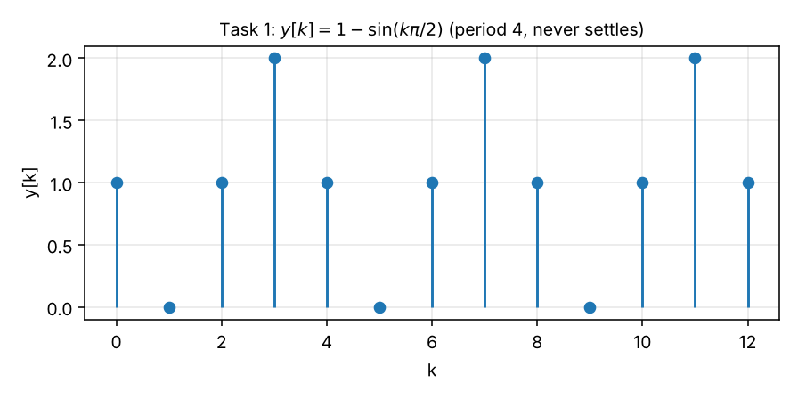
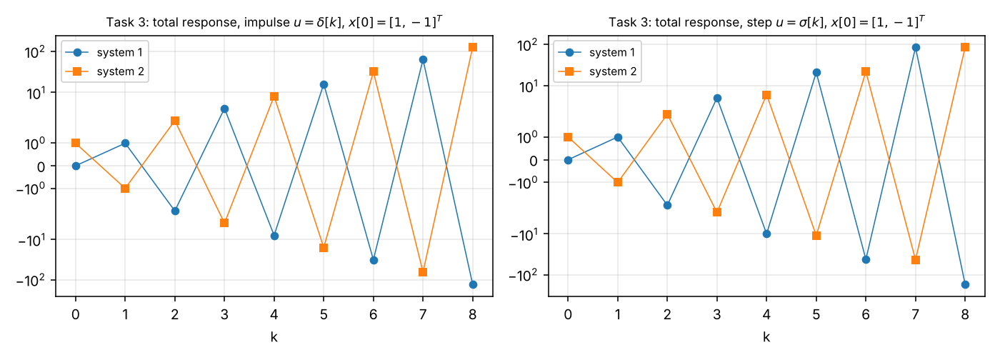
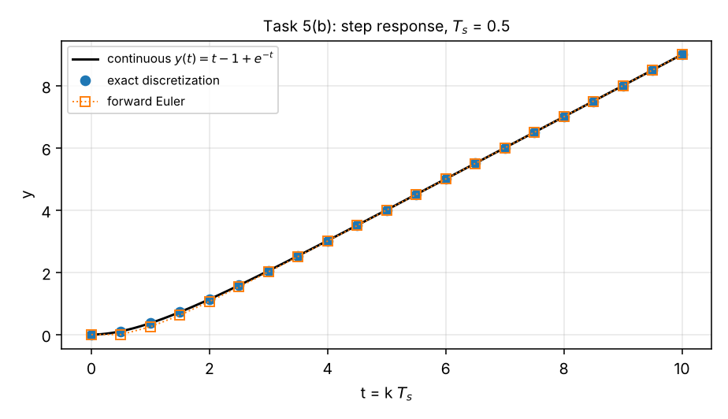
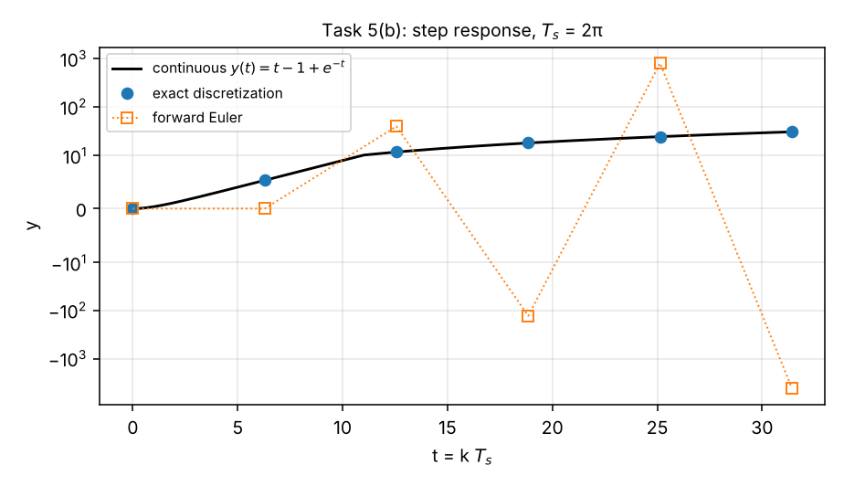

# Exercise 4 — Step-by-Step Solutions

**Course:** Advanced System Theory (Paderborn University, Automatic Control Group RAT, Prof. Dr. Erdal Kayacan)
**Covers:** Task 1 (a–c), Task 2 (a–d), Task 3, Task 4 (a–b), Task 5 (a–b)
**Checking:** no official solution was available when this was written. Every result is verified by the scripts in [`python/`](python/) — symbolic algebra (SymPy), step-by-step simulation of the difference equations, and comparison with `scipy.signal.cont2discrete`.

Every step is written out. References like "Concepts §6.3" point to [`concepts.md`](concepts.md). Notation as in the lecture: $\boldsymbol{x}[k]$, $\boldsymbol{\Phi}[k, k_0] = \boldsymbol{A}^{k - k_0}$, $\boldsymbol{H}[k]$ impulse response, $\sigma[k]$ unit step, $\delta[k]$ unit impulse, $T_s$ sampling interval, $\boldsymbol{A}_d$, $\boldsymbol{B}_d$ exact and $\tilde{\boldsymbol{A}}_d$, $\tilde{\boldsymbol{B}}_d$ forward-Euler discrete matrices.

---

## Contents

- [Task 1 — Response of discrete systems](#task-1--response-of-discrete-systems)
- [Task 2 — Reachable states](#task-2--reachable-states)
- [Task 3 — Response of discrete systems 2](#task-3--response-of-discrete-systems-2)
- [Task 4 — Discretization](#task-4--discretization)
- [Task 5 — Discretization 2](#task-5--discretization-2)
- [Summary of results](#summary-of-results)

---

## Task 1 — Response of discrete systems

$$
\boldsymbol{x}[k+1] = \underbrace{\begin{bmatrix}0 & 1\\ -1 & 0\end{bmatrix}}_{\boldsymbol{A}}\boldsymbol{x}[k] + \underbrace{\begin{bmatrix}1\\ 1\end{bmatrix}}_{\boldsymbol{B}}u[k],\qquad
y[k] = \underbrace{\begin{bmatrix}1 & 0\end{bmatrix}}_{\boldsymbol{C}}\boldsymbol{x}[k],\qquad
\boldsymbol{x}[0] = \begin{bmatrix}1\\ -1\end{bmatrix},\qquad u[k] = \sigma[k].
$$

The step means $u[k] = 1$ for every $k\ge0$. Note $\boldsymbol{A}\begin{bmatrix}a\\ b\end{bmatrix} = \begin{bmatrix}b\\ -a\end{bmatrix}$ (swap, then negate the second entry).

### 1(a) — First three steps

Run the recipe $\boldsymbol{x}[k+1] = \boldsymbol{A}\boldsymbol{x}[k] + \boldsymbol{B}\cdot1$ (Concepts §2.2):

$$
\boldsymbol{x}[1] = \begin{bmatrix}0\cdot1 + 1\cdot(-1)\\ -1\cdot1 + 0\cdot(-1)\end{bmatrix} + \begin{bmatrix}1\\ 1\end{bmatrix} = \begin{bmatrix}-1\\ -1\end{bmatrix} + \begin{bmatrix}1\\ 1\end{bmatrix} = \boxed{\begin{bmatrix}0\\ 0\end{bmatrix}}
$$

$$
\boldsymbol{x}[2] = \boldsymbol{A}\begin{bmatrix}0\\ 0\end{bmatrix} + \begin{bmatrix}1\\ 1\end{bmatrix} = \boxed{\begin{bmatrix}1\\ 1\end{bmatrix}},\qquad
\boldsymbol{x}[3] = \begin{bmatrix}1\\ -1\end{bmatrix} + \begin{bmatrix}1\\ 1\end{bmatrix} = \boxed{\begin{bmatrix}2\\ 0\end{bmatrix}}
$$

One more step is revealing: $\boldsymbol{x}[4] = \begin{bmatrix}0\\ -2\end{bmatrix} + \begin{bmatrix}1\\ 1\end{bmatrix} = \begin{bmatrix}1\\ -1\end{bmatrix} = \boldsymbol{x}[0]$. **The state returns to its start after 4 steps** — the response is periodic.

### 1(b) — General solution $\boldsymbol{x}[k]$

**Step 1 — Powers of $\boldsymbol{A}$** (Concepts §4.3). $\boldsymbol{A}^2 = \begin{bmatrix}0 & 1\\ -1 & 0\end{bmatrix}^2 = \begin{bmatrix}-1 & 0\\ 0 & -1\end{bmatrix} = -\boldsymbol{I}$, hence $\boldsymbol{A}^3 = -\boldsymbol{A}$, $\boldsymbol{A}^4 = \boldsymbol{I}$, and

$$
\boldsymbol{A}^k = \cos\Big(\frac{k\pi}{2}\Big)\boldsymbol{I} + \sin\Big(\frac{k\pi}{2}\Big)\boldsymbol{A} = \begin{bmatrix}\cos\frac{k\pi}{2} & \sin\frac{k\pi}{2}\\ -\sin\frac{k\pi}{2} & \cos\frac{k\pi}{2}\end{bmatrix}.
$$

*Check:* $k = 0, 1, 2, 3$ gives $\boldsymbol{I}, \boldsymbol{A}, -\boldsymbol{I}, -\boldsymbol{A}$ ✓. (Eigenvalues $\pm j = e^{\pm j\pi/2}$: $\lvert\lambda\rvert = 1$, a quarter turn per step.)

**Step 2 — General formula** (Concepts §5.1):

$$
\boldsymbol{x}[k] = \boldsymbol{A}^k\boldsymbol{x}[0] + \sum_{j=0}^{k-1}\boldsymbol{A}^{(k-1)-j}\boldsymbol{B}u[j] = \boldsymbol{A}^k\boldsymbol{x}[0] + \sum_{i=0}^{k-1}\boldsymbol{A}^{i}\boldsymbol{B}.
$$

**Step 3 — Evaluate the sum with the fixed point** (Concepts §6.3). $1$ is not an eigenvalue of $\boldsymbol{A}$, so the constant input has a fixed point $\boldsymbol{x}^\ast = \boldsymbol{A}\boldsymbol{x}^\ast + \boldsymbol{B}$:

$$
\boldsymbol{I} - \boldsymbol{A} = \begin{bmatrix}1 & -1\\ 1 & 1\end{bmatrix},\quad (\boldsymbol{I} - \boldsymbol{A})^{-1} = \frac12\begin{bmatrix}1 & 1\\ -1 & 1\end{bmatrix},\quad
\boldsymbol{x}^\ast = (\boldsymbol{I} - \boldsymbol{A})^{-1}\boldsymbol{B} = \frac12\begin{bmatrix}2\\ 0\end{bmatrix} = \begin{bmatrix}1\\ 0\end{bmatrix}.
$$

*Check:* $\boldsymbol{A}\boldsymbol{x}^\ast + \boldsymbol{B} = [0, -1]^\top + [1, 1]^\top = [1, 0]^\top$ ✓. Then $\boldsymbol{x}[k] = \boldsymbol{A}^k(\boldsymbol{x}[0] - \boldsymbol{x}^\ast) + \boldsymbol{x}^\ast$ with $\boldsymbol{x}[0] - \boldsymbol{x}^\ast = [0, -1]^\top$:

$$
\boldsymbol{A}^k\begin{bmatrix}0\\ -1\end{bmatrix} = \begin{bmatrix}-\sin\frac{k\pi}{2}\\ -\cos\frac{k\pi}{2}\end{bmatrix}
\qquad\Longrightarrow\qquad
\boxed{\;\boldsymbol{x}[k] = \begin{bmatrix}1 - \sin\frac{k\pi}{2}\\[2pt] -\cos\frac{k\pi}{2}\end{bmatrix},\quad k\ge0\;}
$$

(Equivalently, without the fixed point: $\sum_{i=0}^{k-1}\boldsymbol{A}^i\boldsymbol{B} = (\boldsymbol{I} - \boldsymbol{A})^{-1}(\boldsymbol{I} - \boldsymbol{A}^k)\boldsymbol{B}$ — same result.)

*Check against (a):* $k = 0$: $[1, -1]^\top$ ✓; $k = 1$: $[1 - 1, -0]^\top = [0, 0]^\top$ ✓; $k = 2$: $[1 - 0, -(-1)]^\top = [1, 1]^\top$ ✓; $k = 3$: $[1 + 1, -0]^\top = [2, 0]^\top$ ✓.

**Interpretation.** The state **circles around the fixed point** $\boldsymbol{x}^\ast = [1, 0]^\top$ at distance 1, making a quarter turn per step: $[1,-1]\to[0,0]\to[1,1]\to[2,0]\to[1,-1]\to\dots$ Because $\lvert\lambda\rvert = 1$ the deviation from $\boldsymbol{x}^\ast$ neither decays nor grows — the step response **never settles** (marginally stable).

### 1(c) — Total output response

$\boldsymbol{D} = 0$, so $y[k] = \boldsymbol{C}\boldsymbol{x}[k] = x_1[k]$:

$$
\boxed{\;y[k] = 1 - \sin\Big(\frac{k\pi}{2}\Big),\quad k\ge0\qquad\Longrightarrow\qquad y = 1,\ 0,\ 1,\ 2,\ 1,\ 0,\ 1,\ 2,\ \dots\;}
$$

**Split into the two parts** (Concepts §5.2):

- zero-input: $\boldsymbol{C}\boldsymbol{A}^k\boldsymbol{x}[0] = \cos\frac{k\pi}{2} - \sin\frac{k\pi}{2}$ (the first row of $\boldsymbol{A}^k$ times $[1, -1]^\top$);
- zero-state: $\boldsymbol{C}(\boldsymbol{I} - \boldsymbol{A})^{-1}(\boldsymbol{I} - \boldsymbol{A}^k)\boldsymbol{B} = 1 - \cos\frac{k\pi}{2}$;
- sum: $1 - \sin\frac{k\pi}{2}$ ✓.

*Check:* `python/task1_discrete_response.py` (exact rational arithmetic for $k = 0,\dots,12$).

---

## Task 2 — Reachable states

$$
\boldsymbol{x}[k+1] = \underbrace{\begin{bmatrix}0 & 1\\ -0.5 & -1\end{bmatrix}}_{\boldsymbol{A}}\boldsymbol{x}[k] + \underbrace{\begin{bmatrix}1\\ 2\end{bmatrix}}_{\boldsymbol{B}}u[k].
$$

### 2(a) — From $\boldsymbol{x}[0] = \boldsymbol{0}$, at most 2 steps are needed

**Step 1 — State after $k$ steps.** With $\boldsymbol{x}[0] = \boldsymbol{0}$ (Concepts §7.2):

$$
\boldsymbol{x}[k] = \sum_{j=0}^{k-1}\boldsymbol{A}^{(k-1)-j}\boldsymbol{B}u[j] = \boldsymbol{B}u[k-1] + \boldsymbol{A}\boldsymbol{B}u[k-2] + \boldsymbol{A}^2\boldsymbol{B}u[k-3] + \dots + \boldsymbol{A}^{k-1}\boldsymbol{B}u[0].
$$

Every reachable state is a linear combination of $\boldsymbol{B}, \boldsymbol{A}\boldsymbol{B}, \boldsymbol{A}^2\boldsymbol{B}, \dots$

**Step 2 — Cayley–Hamilton.** $\det(\lambda\boldsymbol{I} - \boldsymbol{A}) = \lambda(\lambda + 1) + 0.5 = \lambda^2 + \lambda + 0.5$, so

$$
\boldsymbol{A}^2 + \boldsymbol{A} + 0.5\boldsymbol{I} = \boldsymbol{0}\qquad\Longrightarrow\qquad \boldsymbol{A}^2 = -\boldsymbol{A} - 0.5\boldsymbol{I}.
$$

*Check:* $\boldsymbol{A}^2 = \begin{bmatrix}-0.5 & -1\\ 0.5 & 0.5\end{bmatrix}$ and $-\boldsymbol{A} - 0.5\boldsymbol{I} = \begin{bmatrix}-0.5 & -1\\ 0.5 & 1 - 0.5\end{bmatrix}$ ✓.

**Step 3 — Higher powers add nothing new.** Multiply by $\boldsymbol{B}$: $\boldsymbol{A}^2\boldsymbol{B} = -\boldsymbol{A}\boldsymbol{B} - 0.5\boldsymbol{B}\in\operatorname{span}\{\boldsymbol{B}, \boldsymbol{A}\boldsymbol{B}\}$. Multiplying the identity by $\boldsymbol{A}$ again, $\boldsymbol{A}^3\boldsymbol{B} = -\boldsymbol{A}^2\boldsymbol{B} - 0.5\boldsymbol{A}\boldsymbol{B}$ is also in that span, and by induction every $\boldsymbol{A}^m\boldsymbol{B}$, $m\ge2$. Therefore, for any $k\ge2$, $\boldsymbol{x}[k]$ can be rewritten as

$$
\boldsymbol{x}[k] = \boldsymbol{B}\,v_1 + \boldsymbol{A}\boldsymbol{B}\,v_0\quad\text{for some numbers } v_0, v_1,
$$

which is exactly what **two** steps produce with $u[0] = v_0$, $u[1] = v_1$: $\boldsymbol{x}[2] = \boldsymbol{A}\boldsymbol{B}u[0] + \boldsymbol{B}u[1]$.

**Step 4 — Conclusion.** Any state that can be reached in some number $k$ of steps lies in $\operatorname{span}\{\boldsymbol{B}, \boldsymbol{A}\boldsymbol{B}\}$ and can therefore be reached in 2 steps. (If $k = 1$ it is reachable in one step, which is "at most 2".) ∎

**Here every state is reachable:** $\boldsymbol{A}\boldsymbol{B} = \begin{bmatrix}0\cdot1 + 1\cdot2\\ -0.5\cdot1 - 1\cdot2\end{bmatrix} = \begin{bmatrix}2\\ -2.5\end{bmatrix}$ and

$$
\det\begin{bmatrix}\boldsymbol{B} & \boldsymbol{A}\boldsymbol{B}\end{bmatrix} = \det\begin{bmatrix}1 & 2\\ 2 & -2.5\end{bmatrix} = -2.5 - 4 = -6.5\ne0,
$$

so $\boldsymbol{B}$ and $\boldsymbol{A}\boldsymbol{B}$ span all of $\mathbb{R}^2$.

### 2(b) — Inputs that reach $\boldsymbol{x}_{des} = [4,\ 2]^\top$

**One step is not enough:** $\boldsymbol{x}[1] = \boldsymbol{B}u[0] = [u[0],\ 2u[0]]^\top$ always has $x_2 = 2x_1$, but $\boldsymbol{x}_{des}$ has $x_2 = 2\ne2\cdot4 = 8$. So two steps are needed.

**Two steps:** $\boldsymbol{x}[2] = \boldsymbol{A}\boldsymbol{B}u[0] + \boldsymbol{B}u[1]$:

$$
u[0]\begin{bmatrix}2\\ -2.5\end{bmatrix} + u[1]\begin{bmatrix}1\\ 2\end{bmatrix} = \begin{bmatrix}4\\ 2\end{bmatrix}
\iff
\begin{cases}2u[0] + u[1] = 4\\ -2.5u[0] + 2u[1] = 2\end{cases}
$$

From the first equation $u[1] = 4 - 2u[0]$; insert into the second: $-2.5u[0] + 8 - 4u[0] = 2$ ⇒ $6.5u[0] = 6$:

$$
\boxed{\;u[0] = \frac{12}{13}\approx0.923,\qquad u[1] = 4 - \frac{24}{13} = \frac{28}{13}\approx2.154\;}
$$

**Check by simulation:**

$$
\boldsymbol{x}[1] = \boldsymbol{B}u[0] = \frac{1}{13}\begin{bmatrix}12\\ 24\end{bmatrix},\qquad
\boldsymbol{x}[2] = \boldsymbol{A}\boldsymbol{x}[1] + \boldsymbol{B}u[1] = \frac{1}{13}\begin{bmatrix}24\\ -6 - 24\end{bmatrix} + \frac{1}{13}\begin{bmatrix}28\\ 56\end{bmatrix} = \frac{1}{13}\begin{bmatrix}52\\ 26\end{bmatrix} = \begin{bmatrix}4\\ 2\end{bmatrix}\ \checkmark
$$

The two-step solution is **unique** ($\det\ne0$). With more steps there are infinitely many input sequences (more unknowns than equations).

### 2(c) — General $\boldsymbol{A}\in\mathbb{R}^{n\times n}$: at most $n$ steps

**Claim:** with $\boldsymbol{x}[0] = \boldsymbol{0}$, every state that is reachable at all is reachable in at most $n$ steps.

**Proof** (Concepts §7.3).

1. *Reachable set after $k$ steps.* $\boldsymbol{x}[k] = \sum_{i=0}^{k-1}\boldsymbol{A}^i\boldsymbol{B}u[k-1-i] = \boldsymbol{R}_k\boldsymbol{U}_k$ with $\boldsymbol{R}_k = [\boldsymbol{B}\ \ \boldsymbol{A}\boldsymbol{B}\ \cdots\ \boldsymbol{A}^{k-1}\boldsymbol{B}]$, so the set $\mathcal{R}_k$ of states reachable in exactly $k$ steps is $\operatorname{Im}\boldsymbol{R}_k$ (all combinations of its columns). This also holds for several inputs ($\boldsymbol{B}\in\mathbb{R}^{n\times m}$).
2. *Cayley–Hamilton.* With $\det(\lambda\boldsymbol{I} - \boldsymbol{A}) = \lambda^n + c_{n-1}\lambda^{n-1} + \dots + c_0$:
   $\boldsymbol{A}^n = -c_{n-1}\boldsymbol{A}^{n-1} - \dots - c_1\boldsymbol{A} - c_0\boldsymbol{I}$.
3. *Induction.* For every $m\ge n$, $\boldsymbol{A}^m\boldsymbol{B}$ is a linear combination of $\boldsymbol{B},\dots,\boldsymbol{A}^{n-1}\boldsymbol{B}$. Base $m = n$: multiply step 2 by $\boldsymbol{B}$. Step $m\to m+1$: $\boldsymbol{A}^{m+1}\boldsymbol{B} = \boldsymbol{A}(\boldsymbol{A}^m\boldsymbol{B}) = \sum_{i=0}^{n-1}\beta_i\boldsymbol{A}^{i+1}\boldsymbol{B}$; every term except $\beta_{n-1}\boldsymbol{A}^n\boldsymbol{B}$ is already in the list, and that one is by the base case.
4. *Consequence.* For $k\ge n$ the extra columns of $\boldsymbol{R}_k$ are combinations of the first $n$ blocks, so $\mathcal{R}_k = \operatorname{Im}\boldsymbol{R}_k = \operatorname{Im}\boldsymbol{R}_n = \mathcal{R}_n$.
5. *Fewer steps are covered too.* For $k < n$: $\mathcal{R}_k\subseteq\mathcal{R}_n$, because the inputs $u[0] = \dots = u[n-k-1] = 0$ keep the state at $\boldsymbol{0}$ and the remaining $k$ inputs reproduce the $k$-step result. (Equivalently: the columns of $\boldsymbol{R}_k$ are among those of $\boldsymbol{R}_n$.)
6. Hence $\bigcup_k\mathcal{R}_k = \mathcal{R}_n$: anything reachable is reachable in $n$ steps. ∎

The matrix $\boldsymbol{R}_n$ is the **reachability matrix**; if $\operatorname{rank}\boldsymbol{R}_n = n$, every state is reachable (Week 11).

### 2(d) — (Hard) Nonzero initial state

**No — the statement does not hold for an arbitrary system with $\boldsymbol{x}[0]\ne\boldsymbol{0}$.**

**Why the proof breaks.** Now $\boldsymbol{x}[k] = \boldsymbol{A}^k\boldsymbol{x}[0] + \boldsymbol{R}_k\boldsymbol{U}_k$. The states reachable at step $k$ form the shifted set $\boldsymbol{A}^k\boldsymbol{x}[0] + \operatorname{Im}\boldsymbol{R}_k$. Cayley–Hamilton still freezes $\operatorname{Im}\boldsymbol{R}_k$ for $k\ge n$, but the **shift $\boldsymbol{A}^k\boldsymbol{x}[0]$ keeps moving** with $k$. Step 5 of the proof also fails: a zero input no longer keeps the state still, so "waiting" changes where you are.

**Counterexample** ($n = 2$):

$$
\boldsymbol{A} = \begin{bmatrix}2 & 0\\ 0 & 1\end{bmatrix},\quad \boldsymbol{B} = \begin{bmatrix}0\\ 1\end{bmatrix},\quad \boldsymbol{x}[0] = \begin{bmatrix}1\\ 0\end{bmatrix}.
$$

The input only affects $x_2$, and $x_1$ evolves freely: $x_1[k] = 2^k$. The target $\boldsymbol{x}_{des} = [8,\ 0]^\top$ is reached at $k = 3$ (choose $u[0] = u[1] = u[2] = 0$), but **at no $k\le2$**, since $x_1[1] = 2$ and $x_1[2] = 4$. So a state is reachable, yet only after $3 > n$ steps. (Similarly $[2^m, 0]^\top$ needs exactly $m$ steps, for any $m$.)

**When does it still hold?** If the system is **reachable**, $\operatorname{rank}\boldsymbol{R}_n = n$, then for every $\boldsymbol{x}[0]$ and every $\boldsymbol{x}_{des}$ the equation $\boldsymbol{R}_n\boldsymbol{U}_n = \boldsymbol{x}_{des} - \boldsymbol{A}^n\boldsymbol{x}[0]$ has a solution, so $n$ steps always suffice. The system of 2(a) is of this kind ($\det[\boldsymbol{B}\ \boldsymbol{A}\boldsymbol{B}] = -6.5\ne0$), so for it the statement *does* hold from any initial state. The counterexample has $\operatorname{rank}[\boldsymbol{B}\ \boldsymbol{A}\boldsymbol{B}] = \operatorname{rank}\begin{bmatrix}0 & 0\\ 1 & 1\end{bmatrix} = 1 < 2$.

*Check:* `python/task2_reachability.py`.

---

## Task 3 — Response of discrete systems 2

Two systems, both with $\boldsymbol{x}[0] = [1,\ -1]^\top$:

$$
\text{System 1: } \boldsymbol{A} = \begin{bmatrix}-1 & 0\\ 0 & -2\end{bmatrix},\ \boldsymbol{B} = \begin{bmatrix}1\\ -1\end{bmatrix},\ \boldsymbol{C} = \begin{bmatrix}1 & 1\end{bmatrix};\qquad
\text{System 2: } \boldsymbol{A} = \begin{bmatrix}0 & 1\\ -2 & -3\end{bmatrix},\ \boldsymbol{B} = \begin{bmatrix}0\\ 1\end{bmatrix},\ \boldsymbol{C} = \begin{bmatrix}1 & 0\end{bmatrix}.
$$

$\boldsymbol{D} = 0$ in both. Plan for each system (Concepts §5.2, §6):

$$
y[k] = \underbrace{\boldsymbol{C}\boldsymbol{A}^k\boldsymbol{x}[0]}_{y_{zi}[k]} + \underbrace{\sum_{j=0}^{k-1}\boldsymbol{C}\boldsymbol{A}^{(k-1)-j}\boldsymbol{B}u[j]}_{y_{zs}[k]},\qquad
y_{zs}^{\delta}[k] = H[k] = \boldsymbol{C}\boldsymbol{A}^{k-1}\boldsymbol{B},\qquad
y_{zs}^{\sigma}[k] = \sum_{i=0}^{k-1}\boldsymbol{C}\boldsymbol{A}^{i}\boldsymbol{B}\quad(k\ge1).
$$

At $k = 0$ the zero-state part is $\boldsymbol{D}u[0] = 0$, so $y[0] = \boldsymbol{C}\boldsymbol{x}[0]$ for both inputs.

### System 1 (diagonal)

**Powers.** $\boldsymbol{A}$ is diagonal: $\boldsymbol{A}^k = \operatorname{diag}\big((-1)^k, (-2)^k\big)$.

**Zero-input response.**

$$
\boldsymbol{A}^k\boldsymbol{x}[0] = \begin{bmatrix}(-1)^k\\ -(-2)^k\end{bmatrix},\qquad y_{zi}[k] = (-1)^k - (-2)^k .
$$

**Impulse response** ($k\ge1$):

$$
\boldsymbol{A}^{k-1}\boldsymbol{B} = \begin{bmatrix}(-1)^{k-1}\\ -(-2)^{k-1}\end{bmatrix},\qquad H[k] = (-1)^{k-1} - (-2)^{k-1},\qquad H[0] = 0 .
$$

**Total response to $u = \delta[k]$.** $k = 0$: $y[0] = 1 - 1 = 0$. For $k\ge1$:

$$
y[k] = (-1)^k - (-2)^k + (-1)^{k-1} - (-2)^{k-1} = \underbrace{(-1)^{k-1}(-1 + 1)}_{0} - (-2)^{k-1}(-2 + 1) = (-2)^{k-1}.
$$

$$
\boxed{\;\text{System 1, impulse: } y[0] = 0,\qquad y[k] = (-2)^{k-1}\ (k\ge1):\quad 0,\ 1,\ -2,\ 4,\ -8,\ \dots\;}
$$

**Step response.** With the scalar geometric sums $\sum_{i=0}^{k-1}(-1)^i = \frac{1 - (-1)^k}{2}$ and $\sum_{i=0}^{k-1}(-2)^i = \frac{1 - (-2)^k}{3}$ (Concepts §6.3):

$$
y_{zs}[k] = \sum_{i=0}^{k-1}\big[(-1)^i - (-2)^i\big] = \frac{1 - (-1)^k}{2} - \frac{1 - (-2)^k}{3} = \frac16 - \frac12(-1)^k + \frac13(-2)^k .
$$

Adding $y_{zi}$:

$$
\boxed{\;\text{System 1, step: } y[k] = \frac16 + \frac12(-1)^k - \frac23(-2)^k,\quad k\ge0:\quad 0,\ 1,\ -2,\ 5,\ -10,\ \dots\;}
$$

(The formula also gives the right value $0$ at $k = 0$.) *Check by iteration:* $\boldsymbol{x}[1] = \boldsymbol{A}\boldsymbol{x}[0] + \boldsymbol{B} = [-1, 2]^\top + [1, -1]^\top = [0, 1]^\top$, $y[1] = 1$ ✓; $\boldsymbol{x}[2] = [0, -2]^\top + [1, -1]^\top = [1, -3]^\top$, $y[2] = -2$ ✓ (formula: $\frac16 + \frac12 - \frac83 = -2$ ✓).

### System 2 (companion form)

**Step 1 — Eigenvalues and eigenvectors.** $\det(\lambda\boldsymbol{I} - \boldsymbol{A}) = \lambda(\lambda + 3) + 2 = (\lambda + 1)(\lambda + 2)$ ⇒ $\lambda_1 = -1$, $\lambda_2 = -2$ (same as system 1).

- $\lambda_1 = -1$: $\lambda_1\boldsymbol{I} - \boldsymbol{A} = \begin{bmatrix}-1 & -1\\ 2 & 2\end{bmatrix}$ ⇒ $p_1 + p_2 = 0$ ⇒ $\boldsymbol{p}_1 = [1,\ -1]^\top$.
- $\lambda_2 = -2$: $\lambda_2\boldsymbol{I} - \boldsymbol{A} = \begin{bmatrix}-2 & -1\\ 2 & 1\end{bmatrix}$ ⇒ $2p_1 + p_2 = 0$ ⇒ $\boldsymbol{p}_2 = [1,\ -2]^\top$.

**Step 2 — Decompose the vectors we need to propagate** (Concepts §4.1, "decompose the vector"):

- $\boldsymbol{x}[0] = [1, -1]^\top = \boldsymbol{p}_1$ — **already an eigenvector**, so $\boldsymbol{A}^k\boldsymbol{x}[0] = (-1)^k\boldsymbol{p}_1$.
- $\boldsymbol{B} = [0, 1]^\top = c_1\boldsymbol{p}_1 + c_2\boldsymbol{p}_2$: $c_1 + c_2 = 0$, $-c_1 - 2c_2 = 1$ ⇒ $c_2 = -1$, $c_1 = 1$. So $\boldsymbol{B} = \boldsymbol{p}_1 - \boldsymbol{p}_2$ and $\boldsymbol{A}^{m}\boldsymbol{B} = (-1)^m\boldsymbol{p}_1 - (-2)^m\boldsymbol{p}_2$.

**Step 3 — Zero-input response and impulse response.** $\boldsymbol{C} = [1\ 0]$ picks the first entry, which is $1$ in both $\boldsymbol{p}_1$ and $\boldsymbol{p}_2$:

$$
y_{zi}[k] = (-1)^k,\qquad H[k] = \boldsymbol{C}\boldsymbol{A}^{k-1}\boldsymbol{B} = (-1)^{k-1} - (-2)^{k-1}\ (k\ge1),\qquad H[0] = 0 .
$$

**Step 4 — Total response to $u = \delta[k]$.** $k = 0$: $y[0] = \boldsymbol{C}\boldsymbol{x}[0] = 1$. For $k\ge1$: $y[k] = (-1)^k + (-1)^{k-1} - (-2)^{k-1} = -(-2)^{k-1}$.

$$
\boxed{\;\text{System 2, impulse: } y[0] = 1,\qquad y[k] = -(-2)^{k-1}\ (k\ge1):\quad 1,\ -1,\ 2,\ -4,\ 8,\ \dots\;}
$$

**Step 5 — Step response.** $y_{zs}$ is the same geometric sum as for system 1, $\frac16 - \frac12(-1)^k + \frac13(-2)^k$; adding $y_{zi} = (-1)^k$:

$$
\boxed{\;\text{System 2, step: } y[k] = \frac16 + \frac12(-1)^k + \frac13(-2)^k,\quad k\ge0:\quad 1,\ -1,\ 2,\ -3,\ 6,\ \dots\;}
$$

*Check by iteration:* $\boldsymbol{x}[1] = \boldsymbol{A}\boldsymbol{x}[0] + \boldsymbol{B} = [-1, 1]^\top + [0, 1]^\top = [-1, 2]^\top$, $y[1] = -1$ ✓; $\boldsymbol{x}[2] = [2, 2 - 6]^\top + [0, 1]^\top = [2, -3]^\top$, $y[2] = 2$ ✓.

### Observations

| | System 1 | System 2 |
|---|---|---|
| eigenvalues | $-1, -2$ | $-1, -2$ |
| impulse response $H[k]$ ($k\ge1$) | $(-1)^{k-1} - (-2)^{k-1}$ | $(-1)^{k-1} - (-2)^{k-1}$ |
| zero-input response | $(-1)^k - (-2)^k$ | $(-1)^k$ |
| impulse, total | $(-2)^{k-1}$ | $-(-2)^{k-1}$ |
| step, total | $\frac16 + \frac12(-1)^k - \frac23(-2)^k$ | $\frac16 + \frac12(-1)^k + \frac13(-2)^k$ |

- **Same impulse response:** the two systems have identical **input–output** behaviour from $\boldsymbol{x}[0] = \boldsymbol{0}$ — they are two different state-space *realizations* of the same system (Weeks 6 and 13–14; both have transfer function $\frac{1}{(z + 1)(z + 2)}$). They differ only through the initial state: in system 2, $\boldsymbol{x}[0]$ excites only the $\lambda = -1$ mode.
- **Both responses diverge** with alternating sign: the eigenvalue $-2$ has $\lvert\lambda\rvert = 2 > 1$ (Concepts §4.4), and the input excites it. Both systems are unstable.

*Check:* `python/task3_discrete_responses.py` (exact arithmetic, $k = 0,\dots,11$).

---

## Task 4 — Discretization

For each system: exact (ZOH) discretization $\boldsymbol{A}_d = e^{\boldsymbol{A}T_s}$, $\boldsymbol{B}_d = \int_0^{T_s}e^{\boldsymbol{A}\alpha}\mathrm{d}\alpha\,\boldsymbol{B}$ (Concepts §8), and forward Euler $\tilde{\boldsymbol{A}}_d = \boldsymbol{I} + T_s\boldsymbol{A}$, $\tilde{\boldsymbol{B}}_d = T_s\boldsymbol{B}$ (Concepts §9). $\boldsymbol{C}$ and $\boldsymbol{D}$ are unchanged. **Both $\boldsymbol{A}$ are singular**, so $\boldsymbol{B}_d = \boldsymbol{A}^{-1}(\boldsymbol{A}_d - \boldsymbol{I})\boldsymbol{B}$ cannot be used; the integral is computed directly (Concepts §8.4).

### 4(a) — Double integrator $\ddot y(t) = u(t)$

**State-space model** (Week 2 recipe, $x_1 = y$, $x_2 = \dot y$): $\dot x_1 = x_2$, $\dot x_2 = u$:

$$
\boldsymbol{A} = \begin{bmatrix}0 & 1\\ 0 & 0\end{bmatrix},\quad \boldsymbol{B} = \begin{bmatrix}0\\ 1\end{bmatrix},\quad \boldsymbol{C} = \begin{bmatrix}1 & 0\end{bmatrix},\quad \boldsymbol{D} = 0 .
$$

**Matrix exponential.** $\boldsymbol{A}^2 = \boldsymbol{0}$ (nilpotent), so $e^{\boldsymbol{A}\alpha} = \boldsymbol{I} + \boldsymbol{A}\alpha = \begin{bmatrix}1 & \alpha\\ 0 & 1\end{bmatrix}$.

**Exact discretization.**

$$
\boldsymbol{A}_d = e^{\boldsymbol{A}T_s} = \begin{bmatrix}1 & T_s\\ 0 & 1\end{bmatrix},\qquad
\boldsymbol{B}_d = \int_0^{T_s}\begin{bmatrix}1 & \alpha\\ 0 & 1\end{bmatrix}\begin{bmatrix}0\\ 1\end{bmatrix}\mathrm{d}\alpha = \int_0^{T_s}\begin{bmatrix}\alpha\\ 1\end{bmatrix}\mathrm{d}\alpha = \begin{bmatrix}T_s^2/2\\ T_s\end{bmatrix}.
$$

$$
\boxed{\;\boldsymbol{x}[k+1] = \begin{bmatrix}1 & T_s\\ 0 & 1\end{bmatrix}\boldsymbol{x}[k] + \begin{bmatrix}T_s^2/2\\ T_s\end{bmatrix}u[k],\qquad y[k] = \begin{bmatrix}1 & 0\end{bmatrix}\boldsymbol{x}[k]\;}
$$

**Forward Euler.**

$$
\boxed{\;\tilde{\boldsymbol{A}}_d = \boldsymbol{I} + T_s\boldsymbol{A} = \begin{bmatrix}1 & T_s\\ 0 & 1\end{bmatrix},\qquad \tilde{\boldsymbol{B}}_d = T_s\boldsymbol{B} = \begin{bmatrix}0\\ T_s\end{bmatrix},\qquad \boldsymbol{C},\ \boldsymbol{D}\ \text{unchanged}\;}
$$

**Comparison.** $\tilde{\boldsymbol{A}}_d = \boldsymbol{A}_d$ exactly, because $\boldsymbol{A}$ is nilpotent and the exponential series stops after the linear term (Concepts §9.2). The input matrices differ in the first entry: exact discretization contains the school formula $\Delta y = \dot y\,T_s + \frac12uT_s^2$ — the distance covered **during** the interval due to the acceleration $u$. Euler assumes the velocity is constant over the step and misses the $\frac12uT_s^2$ term.

### 4(b) — LTI system

$$
\dot{\boldsymbol{x}}(t) = \begin{bmatrix}-1 & 0\\ 1 & 0\end{bmatrix}\boldsymbol{x}(t) + \begin{bmatrix}1\\ 0\end{bmatrix}u(t),\qquad y(t) = \begin{bmatrix}0 & 1\end{bmatrix}\boldsymbol{x}(t).
$$

($\dot x_1 = -x_1 + u$ is a first-order lag; $\dot x_2 = x_1$ integrates it.)

**Step 1 — Eigenvalues.** Lower triangular ⇒ $\lambda_1 = -1$, $\lambda_2 = 0$ ($\det\boldsymbol{A} = 0$, singular).

**Step 2 — $e^{\boldsymbol{A}t}$ with Cayley–Hamilton** (Week 3; 2×2 formula with $\lambda_1 = -1$, $\lambda_2 = 0$):

$$
\alpha_1(t) = \frac{e^{\lambda_1t} - e^{\lambda_2t}}{\lambda_1 - \lambda_2} = \frac{e^{-t} - 1}{-1} = 1 - e^{-t},\qquad
\alpha_0(t) = \frac{\lambda_1e^{\lambda_2t} - \lambda_2e^{\lambda_1t}}{\lambda_1 - \lambda_2} = \frac{-1 - 0}{-1} = 1,
$$

$$
e^{\boldsymbol{A}t} = \boldsymbol{I} + (1 - e^{-t})\boldsymbol{A} = \begin{bmatrix}1 - (1 - e^{-t}) & 0\\ 1 - e^{-t} & 1\end{bmatrix} = \begin{bmatrix}e^{-t} & 0\\ 1 - e^{-t} & 1\end{bmatrix}.
$$

*Check:* $t = 0$ gives $\boldsymbol{I}$ ✓; derivative at $0$ gives $\begin{bmatrix}-1 & 0\\ 1 & 0\end{bmatrix} = \boldsymbol{A}$ ✓. (Directly: $x_1 = e^{-t}x_{1,0}$, $x_2 = x_{2,0} + (1 - e^{-t})x_{1,0}$.)

**Step 3 — Exact discretization.** $e^{\boldsymbol{A}\alpha}\boldsymbol{B}$ is the first column, $[e^{-\alpha},\ 1 - e^{-\alpha}]^\top$:

$$
\boldsymbol{A}_d = \begin{bmatrix}e^{-T_s} & 0\\ 1 - e^{-T_s} & 1\end{bmatrix},\qquad
\boldsymbol{B}_d = \int_0^{T_s}\begin{bmatrix}e^{-\alpha}\\ 1 - e^{-\alpha}\end{bmatrix}\mathrm{d}\alpha = \begin{bmatrix}1 - e^{-T_s}\\ T_s - 1 + e^{-T_s}\end{bmatrix}.
$$

($\int_0^{T_s}e^{-\alpha}\mathrm{d}\alpha = [-e^{-\alpha}]_0^{T_s} = 1 - e^{-T_s}$; $\int_0^{T_s}(1 - e^{-\alpha})\mathrm{d}\alpha = T_s - (1 - e^{-T_s})$.)

$$
\boxed{\;\boldsymbol{x}[k+1] = \begin{bmatrix}e^{-T_s} & 0\\ 1 - e^{-T_s} & 1\end{bmatrix}\boldsymbol{x}[k] + \begin{bmatrix}1 - e^{-T_s}\\ T_s - 1 + e^{-T_s}\end{bmatrix}u[k],\qquad y[k] = \begin{bmatrix}0 & 1\end{bmatrix}\boldsymbol{x}[k]\;}
$$

**Step 4 — Forward Euler.**

$$
\boxed{\;\tilde{\boldsymbol{A}}_d = \begin{bmatrix}1 - T_s & 0\\ T_s & 1\end{bmatrix},\qquad \tilde{\boldsymbol{B}}_d = \begin{bmatrix}T_s\\ 0\end{bmatrix},\qquad \boldsymbol{C},\ \boldsymbol{D}\ \text{unchanged}\;}
$$

**Comparison.**

- *Consistency:* expanding the exact result for small $T_s$ ($e^{-T_s}\approx1 - T_s$) gives $\boldsymbol{A}_d\approx\tilde{\boldsymbol{A}}_d$ and $\boldsymbol{B}_d\approx[T_s,\ 0]^\top = \tilde{\boldsymbol{B}}_d$ (the second entry $T_s - 1 + e^{-T_s}\approx T_s^2/2$ is second order) ✓.
- *Eigenvalues:* exact $e^{-T_s}$ and $1$; Euler $1 - T_s$ and $1$. The lag pole stays inside the unit circle for **every** $T_s$ in the exact model, but for Euler only if $\lvert1 - T_s\rvert < 1$, i.e. $T_s < 2$ (Concepts §9.3). The eigenvalue $1$ is the integrator, which both methods keep.
- *Euler's $\tilde{\boldsymbol{B}}_d$ has a zero in the second entry:* the input reaches the output $x_2$ only one step later, whereas the exact model already moves $x_2$ during the first interval.

*Check:* `python/task4_discretization.py` (symbolic, and against `scipy.signal.cont2discrete(..., method="zoh")` for $T_s = 0.1, 0.5, 2, 5$).

---

## Task 5 — Discretization 2

$$
\ddot y(t) + \dot y(t) = u(t).
$$

### 5(a) — State-space model and discretization

**State-space model** ($x_1 = y$, $x_2 = \dot y$; $\ddot y = u - \dot y$):

$$
\dot{\boldsymbol{x}} = \underbrace{\begin{bmatrix}0 & 1\\ 0 & -1\end{bmatrix}}_{\boldsymbol{A}}\boldsymbol{x} + \underbrace{\begin{bmatrix}0\\ 1\end{bmatrix}}_{\boldsymbol{B}}u,\qquad y = \underbrace{\begin{bmatrix}1 & 0\end{bmatrix}}_{\boldsymbol{C}}\boldsymbol{x},\quad \boldsymbol{D} = 0 .
$$

(A mass with friction: velocity $x_2$ relaxes towards the force, position $x_1$ integrates the velocity.) Eigenvalues $0$ and $-1$ (upper triangular) — $\boldsymbol{A}$ is **singular**.

**$e^{\boldsymbol{A}t}$ with Cayley–Hamilton** ($\lambda_1 = 0$, $\lambda_2 = -1$):

$$
\alpha_1 = \frac{e^{0} - e^{-t}}{0 - (-1)} = 1 - e^{-t},\qquad \alpha_0 = \frac{0\cdot e^{-t} - (-1)\cdot e^{0}}{1} = 1,\qquad
e^{\boldsymbol{A}t} = \boldsymbol{I} + (1 - e^{-t})\boldsymbol{A} = \begin{bmatrix}1 & 1 - e^{-t}\\ 0 & e^{-t}\end{bmatrix}.
$$

*Check:* $t = 0$ ⇒ $\boldsymbol{I}$ ✓, derivative at $0$ ⇒ $\boldsymbol{A}$ ✓.

**Exact discretization.** $e^{\boldsymbol{A}\alpha}\boldsymbol{B}$ = second column $[1 - e^{-\alpha},\ e^{-\alpha}]^\top$:

$$
\boxed{\;\boldsymbol{A}_d = \begin{bmatrix}1 & 1 - e^{-T_s}\\ 0 & e^{-T_s}\end{bmatrix},\qquad
\boldsymbol{B}_d = \int_0^{T_s}\begin{bmatrix}1 - e^{-\alpha}\\ e^{-\alpha}\end{bmatrix}\mathrm{d}\alpha = \begin{bmatrix}T_s - 1 + e^{-T_s}\\ 1 - e^{-T_s}\end{bmatrix},\qquad \boldsymbol{C}_d = \begin{bmatrix}1 & 0\end{bmatrix}\;}
$$

**Forward Euler.**

$$
\boxed{\;\tilde{\boldsymbol{A}}_d = \boldsymbol{I} + T_s\boldsymbol{A} = \begin{bmatrix}1 & T_s\\ 0 & 1 - T_s\end{bmatrix},\qquad \tilde{\boldsymbol{B}}_d = \begin{bmatrix}0\\ T_s\end{bmatrix},\qquad \boldsymbol{C}_d = \begin{bmatrix}1 & 0\end{bmatrix}\;}
$$

### 5(b) — Step response for $T_s = 0.5$ and $T_s = 2\pi$

$u[k] = \sigma[k]$, $\boldsymbol{x}[0] = \boldsymbol{0}$. (The sheet says "sampling rate $T_s$"; $T_s$ is the sampling *interval* in seconds.)

**Closed form, exact model.** Write $q = e^{-T_s}$.

- Velocity: $x_2[k+1] = q\,x_2[k] + (1 - q)$. Its fixed point is $1$, so $x_2[k] = 1 - q^k$ (Concepts §6.3, scalar version).
- Position: $x_1[k+1] = x_1[k] + (1 - q)x_2[k] + (T_s - 1 + q)$. Summing from $0$ to $k - 1$ with $x_2[i] = 1 - q^i$:

$$
x_1[k] = \sum_{i=0}^{k-1}\big[(1 - q)(1 - q^i) + T_s - 1 + q\big] = \sum_{i=0}^{k-1}\big[T_s - (1 - q)q^i\big] = kT_s - (1 - q)\frac{1 - q^k}{1 - q} = kT_s - 1 + q^k .
$$

$$
\boxed{\;y[k] = kT_s - 1 + e^{-kT_s}\qquad\text{(exact)}\;}
$$

This is **exactly** the continuous step response $y(t) = t - 1 + e^{-t}$ sampled at $t = kT_s$, for every $T_s$ — as promised by exact discretization.

**Closed form, Euler model.** The same computation with $q$ replaced by $p = 1 - T_s$ (now $\tilde{\boldsymbol{B}}_d = [0, T_s]^\top$): $x_2[k] = 1 - p^k$, $x_1[k+1] = x_1[k] + T_s x_2[k]$, so

$$
x_1[k] = \sum_{i=0}^{k-1}T_s(1 - p^i) = kT_s - T_s\frac{1 - p^k}{T_s} = kT_s - 1 + p^k,\qquad
\boxed{\;\tilde y[k] = kT_s - 1 + (1 - T_s)^k\qquad\text{(Euler)}\;}
$$

**The whole difference:** Euler replaces $e^{-T_s}$ by its first-order approximation $1 - T_s$.

**Values.**

| $k$ | 0 | 1 | 2 | 3 | 4 | 5 | 6 |
|---|---|---|---|---|---|---|---|
| exact, $T_s = 0.5$ | 0 | 0.107 | 0.368 | 0.723 | 1.135 | 1.582 | 2.050 |
| Euler, $T_s = 0.5$ | 0 | 0 | 0.250 | 0.625 | 1.063 | 1.531 | 2.016 |
| exact, $T_s = 2\pi$ | 0 | 5.285 | 11.57 | 17.85 | 24.13 | 30.42 | 36.70 |
| Euler, $T_s = 2\pi$ | 0 | 0 | 39.48 | −129.6 | 803.2 | −4086 | 21782 |

**Discussion.**

- **$T_s = 0.5$:** $e^{-0.5} = 0.607$ vs. $1 - 0.5 = 0.5$. Both models are stable (eigenvalues $\{1, 0.607\}$ and $\{1, 0.5\}$) and Euler stays close to the true curve; the error decays and the ramps become parallel. Euler always gives $\tilde y[1] = 0$, because the input reaches the position only through the velocity one step later.
- **$T_s = 2\pi\approx6.28$:** the exact model is still perfect at the samples ($e^{-2\pi}\approx0.002$ — the velocity has practically settled within one interval). Euler's eigenvalue is $1 - 2\pi\approx-5.28$, far outside the unit circle: the Euler model is **unstable** and oscillates with exploding amplitude, although the continuous system is perfectly well-behaved. The stability bound is $T_s < 2$ (Concepts §9.3, pole $-1$).
- The *continuous* plant itself is not asymptotically stable (eigenvalue $0$: the position keeps growing like $t - 1$ under a constant force), but that growth is linear and bounded in slope; Euler's divergence for $T_s = 2\pi$ is exponential and purely a numerical artefact.

*Check:* `python/task5_discretization.py` (closed forms against simulation for both $T_s$).

---

## Summary of results

- **Task 1:** $\boldsymbol{x}[1] = [0, 0]^\top$, $\boldsymbol{x}[2] = [1, 1]^\top$, $\boldsymbol{x}[3] = [2, 0]^\top$; $\boldsymbol{x}[k] = [1 - \sin\frac{k\pi}{2},\ -\cos\frac{k\pi}{2}]^\top$; $y[k] = 1 - \sin\frac{k\pi}{2}$ (period 4: $1, 0, 1, 2, \dots$).
- **Task 2:** Cayley–Hamilton ⇒ $\boldsymbol{A}^m\boldsymbol{B}\in\operatorname{span}\{\boldsymbol{B}, \boldsymbol{A}\boldsymbol{B}\}$, so 2 steps suffice; $u[0] = \frac{12}{13}$, $u[1] = \frac{28}{13}$; general $n$: $n$ steps; nonzero $\boldsymbol{x}[0]$: **not** in general (counterexample $\boldsymbol{A} = \operatorname{diag}(2, 1)$, $\boldsymbol{B} = [0, 1]^\top$), but yes if $\operatorname{rank}[\boldsymbol{B}\ \cdots\ \boldsymbol{A}^{n-1}\boldsymbol{B}] = n$.
- **Task 3:** both systems have $H[k] = (-1)^{k-1} - (-2)^{k-1}$. System 1: impulse $y = (-2)^{k-1}$ ($k\ge1$, $y[0] = 0$), step $y = \frac16 + \frac12(-1)^k - \frac23(-2)^k$. System 2: impulse $y = -(-2)^{k-1}$ ($k\ge1$, $y[0] = 1$), step $y = \frac16 + \frac12(-1)^k + \frac13(-2)^k$.
- **Task 4:** (a) $\boldsymbol{A}_d = \tilde{\boldsymbol{A}}_d = \begin{bmatrix}1 & T_s\\ 0 & 1\end{bmatrix}$, $\boldsymbol{B}_d = [\frac{T_s^2}{2}, T_s]^\top$, $\tilde{\boldsymbol{B}}_d = [0, T_s]^\top$. (b) $\boldsymbol{A}_d = \begin{bmatrix}e^{-T_s} & 0\\ 1 - e^{-T_s} & 1\end{bmatrix}$, $\boldsymbol{B}_d = [1 - e^{-T_s},\ T_s - 1 + e^{-T_s}]^\top$; $\tilde{\boldsymbol{A}}_d = \begin{bmatrix}1 - T_s & 0\\ T_s & 1\end{bmatrix}$, $\tilde{\boldsymbol{B}}_d = [T_s, 0]^\top$.
- **Task 5:** $\boldsymbol{A}_d = \begin{bmatrix}1 & 1 - e^{-T_s}\\ 0 & e^{-T_s}\end{bmatrix}$, $\boldsymbol{B}_d = [T_s - 1 + e^{-T_s},\ 1 - e^{-T_s}]^\top$; $\tilde{\boldsymbol{A}}_d = \begin{bmatrix}1 & T_s\\ 0 & 1 - T_s\end{bmatrix}$, $\tilde{\boldsymbol{B}}_d = [0, T_s]^\top$; step responses $y[k] = kT_s - 1 + e^{-kT_s}$ (exact) and $kT_s - 1 + (1 - T_s)^k$ (Euler) — Euler unstable for $T_s = 2\pi$.
